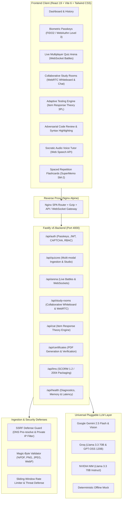

# QuizForge — Enterprise Full-Stack AI Assessment Platform

[](https://github.com/srivastavHimanshu4503/QuizForge/actions)
[-brightgreen)](https://github.com/srivastavHimanshu4503/QuizForge)
[](https://www.typescriptlang.org/)
[](LICENSE)

**QuizForge** is an enterprise-grade, full-stack AI knowledge assessment, proctoring, and collaborative learning platform. It ingests content from diverse multi-modal sources—**PDF documents**, **live URLs**, **diagrams/infographics**, and **GitHub repositories**—to generate rigorous assessments, host real-time multiplayer arenas, power collaborative study rooms with interactive whiteboards, deliver computerized adaptive tests, and authenticate learners using FIDO2 biometric passkeys.

---

## 1. System Architecture

```text
quiz-forge/
├── packages/
│   └── shared/           # Zod schemas, data contracts & inferred TypeScript types
└── apps/
    ├── backend/          # Fastify v5 + Drizzle ORM + SQLite (WAL mode) + Multi-LLM Layer
    └── frontend/         # React 19 + Vite 6 + Tailwind CSS + WebAuthn + WebRTC Whiteboard
```



---

## 2. Core Capabilities Across All 20 Milestones

| Capability | Technical Implementation | Highlights |
| :--- | :--- | :--- |
| **📄 PDF Ingestion** | `pdf-parse` + Magic-byte validation | Validates `%PDF-` binary magic bytes; chunked background parsing with real-time job status polling. |
| **🌐 URL Ingestion** | Cheerio + SSRF Defense Guard | DNS pre-resolution, loopback and private subnet rejection (RFC1918, RFC6598, cloud metadata 169.254.169.254). |
| **🖼️ Image Ingestion** | Gemini Vision + Magic-byte validator | Verifies PNG, JPEG, WebP headers; multimodal visual understanding for diagrams, flowcharts, and notes. |
| **💻 Code Review Quizzes** | GitHub Tree API + PrismJS highlighter | Adversarial code comprehension quizzes with line-by-line syntax highlighting and open-ended evaluation. |
| **🎓 Classrooms & RBAC** | Role-based Fastify middleware | `teacher`, `student`, and `admin` roles; 6-character class codes; assignment deadlines; isolated retakes. |
| **🛠️ Quiz Review Studio** | Human-in-the-loop editor | Edit questions, choices, and explanations; toggle `draft` / `published`; public shareable landing pages. |
| **🛡️ Anti-Cheat Guard** | Fullscreen Proctoring API | Detects tab switching, blur events, window resizing, and developer tools inspection with proctor warnings. |
| **📊 Deep Analytics** | Psychometric statistical engine | Discrimination index ($D$), point-biserial correlation, topic heatmaps, and full CSV/JSON export. |
| **📜 PDF Certificates** | `pdf-lib` + QR code generator | Generates cryptographic verification certificates and student report cards with public `/verify/:code` links. |
| **⚡ Live Quiz Arena** | Fastify WebSockets (`/api/arena/ws`) | Real-time multiplayer battle sessions with 6-digit PINs, live scoreboards, countdown timers, and confetti. |
| **🎯 Adaptive Testing (CAT)**| Item Response Theory (IRT 3PL) | Dynamically calibrates question difficulty ($\beta$), user ability ($\theta$), and Standard Error ($SE$) per response. |
| **📦 LMS / SCORM Packaging** | JSZip + SCORM 1.2 / 2004 manifests | Exports self-contained SCORM packages with `imsmanifest.xml` and interactive HTML quiz players for Moodle/Canvas. |
| **💻 Interactive Code Sandbox** | Isolated Web Worker evaluation | Multi-language code runner supporting JavaScript, Python, and TypeScript with automated unit test assertions. |
| **🎙️ AI Audio Voice Tutor** | Web Speech API (TTS & STT) | Voice-guided quiz player with real-time waveform visualization and socratic spoken feedback. |
| **🧠 Spaced Repetition Flashcards** | SuperMemo SM-2 algorithm | Calculates repetition intervals, Easiness Factor ($EF$), and review scheduling for active recall mastery. |
| **🔒 Enterprise Security** | OWASP Helmet + Sliding-Window Rate Limit | Defends against brute-force attacks, DDoS, SSRF, MIME-sniffing, and clickjacking (`frame-ancestors 'none'`). |
| **👥 Collaborative Study Rooms** | WebRTC + WebSocket Whiteboard | Multi-user interactive canvas with vector strokes, undo/redo, laser pointer, room chat, and voice coordination. |
| **🔑 Biometric WebAuthn Passkeys** | FIDO2 / W3C WebAuthn Level 3 | Passwordless login via Touch ID, Windows Hello, and YubiKeys; Signal API unknown credential synchronization. |
| **🚀 Production Hardening** | Multi-stage Docker + Nginx Reverse Proxy | Sub-200kB initial chunk code splitting, WebSocket upgrade gateways, automated GitHub Actions CI pipeline. |

---

## 3. API Directory

### Authentication & Passkeys (`/api/auth`)
- `POST /api/auth/register` — Register a new account (`student` or `teacher`).
- `POST /api/auth/login` — Authenticate with email/password and receive `HttpOnly` cookie.
- `POST /api/auth/logout` — Revoke active session.
- `GET /api/auth/me` — Retrieve active user session profile and role.
- `POST /api/auth/passkey/register-options` — Generate WebAuthn passkey registration options.
- `POST /api/auth/passkey/register-verify` — Verify attestation and register passkey credential.
- `POST /api/auth/passkey/login-options` — Generate discoverable passkey assertion options.
- `POST /api/auth/passkey/login-verify` — Verify biometric assertion and log user in.
- `GET /api/auth/passkey/credentials` — List user's registered passkey credentials.
- `PUT /api/auth/passkey/credentials/:id` — Rename passkey credential nickname.
- `DELETE /api/auth/passkey/credentials/:id` — Revoke and delete passkey credential.

### Quiz Ingestion & Execution (`/api/quizzes`, `/api/attempts`)
- `POST /api/quizzes/generate` — Generate quiz from topic prompt.
- `POST /api/quizzes/generate/pdf` — Multipart upload for PDF document processing.
- `POST /api/quizzes/generate/url` — Ingest web page with SSRF firewall guard.
- `POST /api/quizzes/generate/image` — Ingest image with multimodal vision parsing.
- `GET /api/jobs/:jobId` — Poll status of asynchronous generation pipelines.
- `GET /api/quizzes/:quizId/studio` — Review quiz questions, answers, and explanations.
- `PUT /api/quizzes/:quizId/studio` — Save modifications to questions and answers.
- `POST /api/quizzes/:quizId/publish` — Publish quiz and generate public share link.
- `GET /api/attempts/:attemptId` — Fetch sanitized active question set.
- `PATCH /api/attempts/:attemptId/answers` — Autosave choice selection.
- `POST /api/attempts/:attemptId/submit` — Finalize attempt and compute score.

### Real-Time Live Quiz Arena & Study Rooms (`/api/arena`, `/api/study-rooms`)
- `POST /api/arena/sessions` — Host creates a new multiplayer arena battle.
- `GET /api/arena/sessions/:pin` — Query arena lobby status and players.
- `GET /api/arena/ws` — WebSocket gateway for live multiplayer question streaming and scoreboard.
- `POST /api/study-rooms` — Create collaborative study room with whiteboard.
- `GET /api/study-rooms/ws` — WebSocket gateway for vector strokes, chat, cursors, and WebRTC signaling.

### Adaptive Testing & LMS (`/api/cat`, `/api/lms`, `/api/certificates`)
- `POST /api/cat/sessions/start` — Start Computerized Adaptive Test session (IRT 3PL).
- `POST /api/cat/sessions/:sessionId/respond` — Submit response and receive calibrated next question.
- `GET /api/lms/scorm/:quizId` — Download packaged SCORM 1.2 or 2004 ZIP archive.
- `GET /api/certificates/:attemptId/pdf` — Download cryptographically signed PDF certificate.
- `GET /api/certificates/verify/:code` — Public endpoint to verify certificate authenticity.

### System Diagnostics (`/api/health`)
- `GET /api/health` — Returns comprehensive system diagnostics: database connection status, query latency, memory consumption, uptime, and environment.

---

## 4. Default Demo Accounts

QuizForge comes pre-configured with role-specific demo accounts:

| Role | Email | Password | Display Name | Permissions |
| :--- | :--- | :--- | :--- | :--- |
| **Teacher (Instructor)** | `teacher@quizforge.dev` | `QuizForge2026!` | Prof. Alan Turing | Create classrooms, issue assignments, review studio, host live arenas. |
| **Student (Learner)** | `student@quizforge.dev` | `QuizForge2026!` | Ada Lovelace | Enroll in classrooms, take quizzes, battle in live arenas, join study rooms. |

---

## 5. Quick Start & Local Development

### Prerequisites
- **Node.js 22+**
- **pnpm 10+** (`npm install -g pnpm`)

### Setup Instructions
```bash
# 1. Clone repository
git clone https://github.com/srivastavHimanshu4503/QuizForge.git
cd QuizForge

# 2. Install workspace dependencies
pnpm install

# 3. Configure environment
cp .env.example .env
# Edit .env with your GEMINI_API_KEY, GROQ_API_KEY, or NVIDIA_API_KEY

# 4. Run database migrations and seed demo accounts
pnpm db:migrate

# 5. Start development servers
pnpm dev
```

- **Frontend Client:** `http://localhost:5173`
- **Backend API:** `http://localhost:4000`

### Automated Verification
```bash
# Run all 222 automated tests across 25 test suites
pnpm test

# Run strict monorepo TypeScript typecheck
pnpm typecheck

# Build frontend and backend production bundles
pnpm build
```

---

## 6. Production Docker Deployment

Deploy QuizForge using the multi-stage containerized stack with Nginx:

```bash
docker compose up -d --build
```

Access the production deployment at `http://localhost`. All SQLite database data is stored in the persistent volume `quizforge-data`.

---

## 7. License

This project is licensed under the MIT License.
