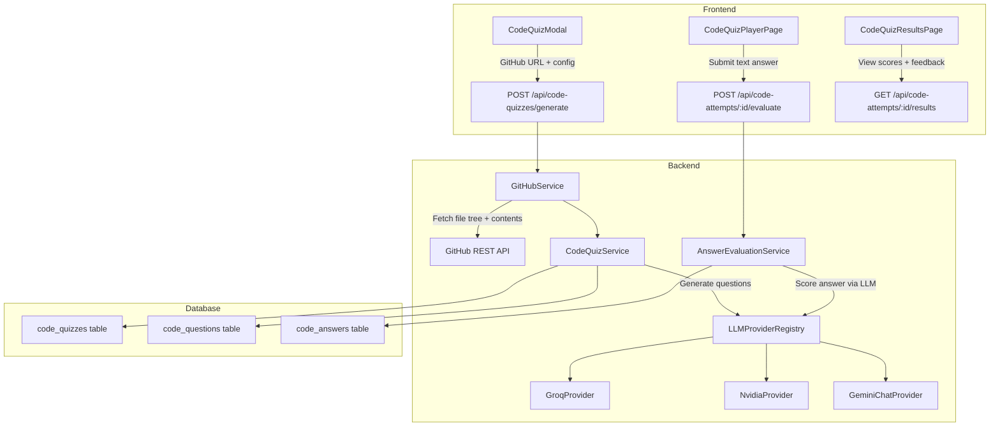

# Code Review Quiz: GitHub Repo-Based Open-Ended Quiz with Multi-LLM Providers

## Goal Description

Add a **new quiz mode** where a user pastes a **public GitHub repository URL**, and the system:
1. **Fetches source code** from the repo via the GitHub REST API (file tree + raw file contents).
2. **Generates deep code-comprehension questions** — logical, conceptual, comment-aware — that test whether the person *truly understands every line they wrote*.
3. Presents questions **with the relevant code snippet** and an **open-ended text box** (not MCQ).
4. **LLM evaluates** the user's free-text answer against the code context, awarding a score (0–10) with feedback.
5. All of this runs on a **pluggable multi-LLM provider system** with concrete implementations for **Groq** and **NVIDIA NIM**, in addition to the existing Gemini provider.

This is a **parallel quiz mode** alongside the existing MCQ mode — it does **not** replace or break existing functionality.

---

## User Review Required

> [!IMPORTANT]
> **This is a new quiz type with fundamentally different mechanics.** MCQ quizzes have fixed correct answers scored deterministically on the server. Code-review quizzes have open-ended answers scored by an LLM. The data model, player UI, and scoring flow are all new.

> [!WARNING]
> **API Keys Required:** You will need to provide API keys for Groq (`GROQ_API_KEY`) and/or NVIDIA (`NVIDIA_API_KEY`) in your `.env` file. The system will gracefully fall back — if a key is missing, that provider is simply unavailable.

> [!IMPORTANT]
> **GitHub API Rate Limits:** Unauthenticated requests to the GitHub API are limited to **60 requests/hour** per IP. For development this is fine, but for heavier use you can optionally add a `GITHUB_TOKEN` to `.env` for 5,000 req/hour.

---

## Decisions (Resolved)

> [!NOTE]
> **1. Provider Selection UI:** ✅ **Dropdown** — user explicitly picks Groq / NVIDIA / Gemini when generating a code quiz.

> [!NOTE]
> **2. File Filtering:** ✅ **Auto-filter** code files only. No manual toggle.

> [!NOTE]
> **3. Smart File Prioritization:** ✅ The system uses a **tiered priority scoring algorithm** to identify the most important files in the repo — not just random sampling. See "Smart File Prioritization" section below for the full strategy.

---

## Architecture Overview



---

## Proposed Changes

### Component 1: Multi-LLM Provider Abstraction Layer

This is the **foundation** — a new unified provider interface that uses the **OpenAI-compatible chat completions format** (which both Groq and NVIDIA support), completely separate from the existing `IAIQuestionGenerator` MCQ interface.

---

#### [NEW] `apps/backend/src/services/llm/llm.interface.ts`

The core abstraction for chat-based LLM providers:

```typescript
export interface ChatMessage {
  role: 'system' | 'user' | 'assistant';
  content: string;
}

export interface LLMCompletionOptions {
  model?: string;
  temperature?: number;
  maxTokens?: number;
  responseFormat?: { type: 'json_object' } | { type: 'text' };
}

export interface LLMCompletionResult {
  content: string;
  model: string;
  promptTokens?: number;
  completionTokens?: number;
}

export interface ILLMProvider {
  readonly name: string;
  readonly isAvailable: boolean;
  
  chatCompletion(
    messages: ChatMessage[],
    options?: LLMCompletionOptions
  ): Promise<LLMCompletionResult>;
}

export class LLMProviderError extends Error {
  constructor(
    message: string,
    public provider: string,
    public code: string,
    public statusCode: number = 502,
    public details?: unknown
  ) {
    super(message);
    this.name = 'LLMProviderError';
  }
}
```

---

#### [NEW] `apps/backend/src/services/llm/groq.provider.ts`

Groq uses a standard OpenAI-compatible API at `https://api.groq.com/openai/v1`:

```typescript
// Uses native fetch — no SDK dependency needed
// Base URL: https://api.groq.com/openai/v1/chat/completions
// Default model: llama-3.3-70b-versatile
// Supports response_format: { type: "json_object" }
// Auth: Bearer token via GROQ_API_KEY
```

Key design decisions:
- **No SDK dependency** — uses Node's native `fetch` to call the OpenAI-compatible endpoint directly. This keeps the dependency footprint minimal and the providers uniform.
- Retry with exponential backoff for 429/503 errors.
- Configurable model (default: `llama-3.3-70b-versatile`).

---

#### [NEW] `apps/backend/src/services/llm/nvidia.provider.ts`

NVIDIA NIM uses `https://integrate.api.nvidia.com/v1`:

```typescript
// Base URL: https://integrate.api.nvidia.com/v1/chat/completions
// Default model: meta/llama-3.3-70b-instruct
// Supports response_format: { type: "json_object" }
// Auth: Bearer token via NVIDIA_API_KEY (nvapi-...)
```

Same architecture as Groq — raw `fetch` against an OpenAI-compatible endpoint.

---

#### [NEW] `apps/backend/src/services/llm/gemini-chat.provider.ts`

Wraps the existing `@google/genai` SDK into the `ILLMProvider` interface so Gemini can also be used for code quiz generation and evaluation:

```typescript
// Reuses existing GoogleGenAI client
// Maps ChatMessage[] to Gemini's content format
// Uses responseMimeType: 'application/json' for JSON mode
```

---

#### [NEW] `apps/backend/src/services/llm/provider-registry.ts`

A singleton registry that discovers available providers from env vars:

```typescript
export class LLMProviderRegistry {
  private providers = new Map<string, ILLMProvider>();

  register(provider: ILLMProvider): void { ... }
  
  get(name: string): ILLMProvider { ... }
  
  getAvailable(): { name: string; models: string[] }[] { ... }
  
  getDefault(): ILLMProvider { ... } // First available
}

// Auto-registers providers based on which API keys exist in env
export const llmRegistry = new LLMProviderRegistry();
```

---

#### [MODIFY] `apps/backend/src/config/env.ts`

Add new environment variables:

```diff
  GEMINI_API_KEY: z.string().default('dev_gemini_key'),
  GEMINI_MODEL: z.string().default('gemini-2.5-flash'),
+ GROQ_API_KEY: z.string().optional(),
+ GROQ_MODEL: z.string().default('llama-3.3-70b-versatile'),
+ NVIDIA_API_KEY: z.string().optional(),
+ NVIDIA_MODEL: z.string().default('meta/llama-3.3-70b-instruct'),
+ GITHUB_TOKEN: z.string().optional(),
```

---

### Component 2: GitHub Repository Fetcher Service

---

#### [NEW] `apps/backend/src/services/github.service.ts`

Responsible for:
1. **Parsing the GitHub URL** → extracting `owner`, `repo`, optional `branch`, and optional subfolder path.
2. **Fetching the file tree** via `GET /repos/{owner}/{repo}/git/trees/{branch}?recursive=1`.
3. **Filtering** to only code files (configurable allowlist of extensions).
4. **Fetching raw file contents** via `https://raw.githubusercontent.com/{owner}/{repo}/{branch}/{path}`.
5. **Respecting size limits** — cap total combined content at ~200KB or ~50 files.

```typescript
export interface RepoFile {
  path: string;        // e.g. "src/services/auth.ts"
  content: string;     // Raw source code
  language: string;    // Detected from extension
  sizeBytes: number;
}

export interface RepoContext {
  owner: string;
  repo: string;
  branch: string;
  files: RepoFile[];
  totalFiles: number;
  truncated: boolean;  // True if repo exceeded limits
  repoUrl: string;
}

export class GitHubService {
  async fetchRepoContext(url: string, options?: {
    maxFiles?: number;        // default 50
    maxTotalBytes?: number;   // default 200_000
    subfolder?: string;       // optional path filter
    extensions?: string[];    // override default allowlist
  }): Promise<RepoContext>;
}
```

**Default extension allowlist:**
```
.ts .tsx .js .jsx .py .rs .go .java .c .cpp .h .hpp .cs .rb .php
.vue .svelte .astro .sql .sh .bash .yaml .yml .toml .json .md
```

**Excluded patterns:**
```
node_modules/ .git/ dist/ build/ vendor/ __pycache__/
*.lock *.min.js *.min.css *.map *.wasm *.png *.jpg *.svg *.ico
```

---

### Smart File Prioritization Algorithm

The system doesn't just grab random files — it **scores every file** in the repo tree and selects the highest-scored files up to the budget (50 files / 200KB). This ensures the LLM sees the **core logic** while still sampling supporting files to avoid tunnel-vision bias.

#### Priority Tiers (Score Multiplier)

| Tier | Score | Pattern / Signal | Rationale |
|------|-------|-----------------|-----------|
| **🔴 Core Entry Points** | **10** | `main.ts`, `index.ts`, `app.ts`, `server.ts`, `mod.rs`, `main.py`, `main.go`, `Program.cs` | The starting point of the entire application |
| **🟠 Service / Business Logic** | **8** | Files in `services/`, `controllers/`, `handlers/`, `usecases/`, `domain/`, `core/` | Where the real logic lives |
| **🟡 Routes / API Layer** | **7** | Files in `routes/`, `api/`, `endpoints/`, or matching `*.routes.*`, `*.controller.*` | Public API surface = high ownership signal |
| **🟢 Data / Schema Layer** | **7** | Files in `db/`, `schema/`, `models/`, `entities/`, `migrations/` | Data structure decisions reveal deep understanding |
| **🔵 Utilities / Helpers** | **5** | Files in `utils/`, `helpers/`, `lib/`, `common/`, `shared/` | Often contain clever logic and edge-case handling |
| **🟣 Config / Setup** | **4** | Files matching `config.*`, `env.*`, `setup.*`, `.env.example`, `Dockerfile` | Config decisions are testable knowledge |
| **⚪ Tests** | **3** | Files in `test/`, `tests/`, `__tests__/`, or matching `*.test.*`, `*.spec.*` | Tests reveal intent, but are lower-priority targets |
| **⬜ Other Code** | **2** | Any code file that doesn't match above patterns | Still included for breadth |

#### Additional Score Bonuses

| Bonus | +Score | Condition |
|-------|--------|-----------|
| **Has comments** | **+2** | File content contains `//`, `#`, `/* */`, or docstrings (checked after fetch) |
| **Medium size** | **+1** | File is 50–500 lines (sweet spot for meaningful questions) |
| **Deep nesting** | **+1** | File is 3+ directories deep (e.g. `src/services/ai/gemini.provider.ts`) — signals specificity |

#### Selection Algorithm

```
1. Fetch repo tree (all file paths)
2. Filter to code extensions only, exclude known junk patterns
3. Score every file by tier + bonuses (using path-only scoring first)
4. Sort descending by score
5. Select top files greedily until budget hit (50 files or 200KB)
6. BIAS GUARD: Ensure at least 20% of selected files are from Tier 5+ (utilities, config, tests)
   — If the top selections are all services/routes, forcibly swap in some lower-tier files
7. Fetch raw content for selected files only
8. Re-score with content-based bonuses (comments detection, line count)
9. Final sorted list → sent to LLM for question generation
```

This ensures:
- The LLM **focuses on the most important code** (services, routes, schemas)
- But also **asks about utilities, configs, and helpers** to catch developers who only know the "main" flow
- Comment-heavy files get boosted because they're the richest source of "do you really understand this?" questions

---

### Component 3: Code Quiz Question Generation (System Prompt)

---

#### [NEW] `apps/backend/src/services/llm/prompts/code-quiz.prompt.ts`

This is the **heart** of the feature. The system prompt must produce questions that:
- Test whether the person **truly wrote and understands** the code
- Ask about **comments** (what they mean, why they're there)
- Ask about **edge cases** and **error handling choices**
- Ask about **naming conventions** and **architecture decisions**
- Ask about **specific logic flows** with code snippets inline

```typescript
export function buildCodeQuizSystemPrompt(): string {
  return `You are a Senior Staff Engineer conducting a rigorous, adversarial code review interview.

Your job is to generate questions that ONLY the person who actually wrote this code would be able to answer confidently. You are testing whether they deeply understand every line, every comment, every architectural decision.

QUESTION PHILOSOPHY:
1. COMMENTS ARE GOLD — If the code has comments, ask what they mean, why they were written, and what would break if the commented behavior changed. Most developers forget their own comments. This is your strongest signal.
2. EDGE CASES — Ask "What happens if X is null/empty/negative here?" pointing at specific lines. The real author knows the answer instinctively.
3. NAMING CHOICES — Ask why a variable/function/class was named the way it was. The real author had a reason.
4. ARCHITECTURE DECISIONS — Ask "Why did you use X pattern instead of Y?" The real author considered alternatives.
5. ERROR HANDLING — Ask what specific error conditions are handled and what happens when they occur.
6. DATA FLOW — Ask the user to trace how data flows through a specific function, what transforms it undergoes.
7. DEPENDENCIES — Ask why specific libraries/imports were chosen over alternatives.
8. SUBTLE BUGS — Point at code that could have a subtle issue and ask the author to explain if/why it's safe.

QUESTION FORMAT RULES:
- Each question MUST include the relevant code snippet (5-30 lines) that the question refers to.
- The code snippet must have line numbers.
- Questions should be specific and unambiguous — never vague.
- Questions should require 2-5 sentence answers, not one-word responses.
- Vary difficulty: mix foundational understanding questions with deep architectural ones.
- NEVER ask questions that can be answered by just reading the code surface — ask about the WHY and WHAT-IF.`;
}

export function buildCodeQuizUserPrompt(params: {
  repoUrl: string;
  files: { path: string; content: string }[];
  questionCount: number;
  focusAreas?: string;
}): string {
  // Assembles the file contents with headers and line numbers
  // Instructs the model to return JSON array of questions
}
```

**Expected JSON output from the LLM:**
```json
{
  "questions": [
    {
      "question_id": "cq_001",
      "question": "In the `verifyCaptcha` function, there's a comment saying 'Allow test bypass in automated testing mode'. What security risk does this bypass introduce, and how does the code mitigate it from being exploitable in production?",
      "code_snippet": {
        "file_path": "src/utils/captcha.ts",
        "start_line": 54,
        "end_line": 68,
        "code": "export function verifyCaptcha(captchaId?: string, userAnswer?: string): boolean {\n  // Allow test bypass in automated testing mode\n  if (env.NODE_ENV === 'test') {\n    ..."
      },
      "difficulty": "hard",
      "expected_concepts": ["environment-based guards", "NODE_ENV trust boundary", "defense in depth"]
    }
  ]
}
```

---

#### [NEW] `apps/backend/src/services/llm/prompts/answer-eval.prompt.ts`

The prompt used to **evaluate** user's free-text answers:

```typescript
export function buildAnswerEvaluationPrompt(params: {
  question: string;
  codeSnippet: string;
  userAnswer: string;
  expectedConcepts: string[];
}): string {
  return `You are a Senior Staff Engineer evaluating a candidate's answer during a code review interview.

EVALUATION CRITERIA:
1. ACCURACY (0-4): Is the answer factually correct about what the code does?
2. DEPTH (0-3): Does the answer show understanding beyond surface-level reading?
3. COMPLETENESS (0-3): Does the answer address all parts of the question?

Score each criterion and provide an overall score (0-10).

Be STRICT but FAIR:
- A perfect 10 means the answer demonstrates author-level mastery
- A 7-8 means solid understanding with minor gaps
- A 4-6 means partial understanding
- Below 4 means significant misconceptions or missing the point

Return your evaluation as JSON.`;
}
```

---

### Component 4: Database Schema (New Tables)

These are **new tables** — the existing MCQ tables are untouched.

---

#### [NEW] `apps/backend/src/db/schema/code-quizzes.ts`

```typescript
export const codeQuizzes = sqliteTable('code_quizzes', {
  id: text('id').primaryKey().$defaultFn(() => crypto.randomUUID()),
  userId: text('user_id').notNull().references(() => users.id, { onDelete: 'cascade' }),
  repoUrl: text('repo_url').notNull(),
  repoOwner: text('repo_owner').notNull(),
  repoName: text('repo_name').notNull(),
  branch: text('branch').notNull().default('main'),
  questionCount: integer('question_count').notNull(),
  llmProvider: text('llm_provider').notNull(), // 'groq' | 'nvidia' | 'gemini'
  llmModel: text('llm_model').notNull(),
  filesAnalyzed: integer('files_analyzed').notNull(),
  createdAt: text('created_at').notNull().$defaultFn(() => new Date().toISOString()),
});
```

---

#### [NEW] `apps/backend/src/db/schema/code-questions.ts`

```typescript
export const codeQuestions = sqliteTable('code_questions', {
  id: text('id').primaryKey().$defaultFn(() => crypto.randomUUID()),
  codeQuizId: text('code_quiz_id').notNull().references(() => codeQuizzes.id, { onDelete: 'cascade' }),
  questionOrder: integer('question_order').notNull(),
  questionText: text('question_text').notNull(),
  codeSnippetPath: text('code_snippet_path').notNull(),
  codeSnippetContent: text('code_snippet_content').notNull(),
  codeSnippetStartLine: integer('code_snippet_start_line'),
  codeSnippetEndLine: integer('code_snippet_end_line'),
  difficulty: text('difficulty', { enum: ['easy', 'medium', 'hard'] }).notNull(),
  expectedConcepts: text('expected_concepts', { mode: 'json' }).$type<string[]>().notNull(),
  createdAt: text('created_at').notNull().$defaultFn(() => new Date().toISOString()),
});
```

---

#### [NEW] `apps/backend/src/db/schema/code-attempts.ts`

```typescript
export const codeAttempts = sqliteTable('code_attempts', {
  id: text('id').primaryKey().$defaultFn(() => crypto.randomUUID()),
  codeQuizId: text('code_quiz_id').notNull().references(() => codeQuizzes.id, { onDelete: 'cascade' }),
  userId: text('user_id').notNull().references(() => users.id, { onDelete: 'cascade' }),
  status: text('status', { enum: ['in_progress', 'completed'] }).notNull().default('in_progress'),
  totalScore: real('total_score'),               // Sum of all answer scores
  maxPossibleScore: integer('max_possible_score'), // questionCount * 10
  accuracyPercentage: real('accuracy_percentage'),
  startedAt: text('started_at').notNull().$defaultFn(() => new Date().toISOString()),
  completedAt: text('completed_at'),
});
```

---

#### [NEW] `apps/backend/src/db/schema/code-answers.ts`

```typescript
export const codeAnswers = sqliteTable('code_answers', {
  id: text('id').primaryKey().$defaultFn(() => crypto.randomUUID()),
  codeAttemptId: text('code_attempt_id').notNull().references(() => codeAttempts.id, { onDelete: 'cascade' }),
  codeQuestionId: text('code_question_id').notNull().references(() => codeQuestions.id, { onDelete: 'cascade' }),
  userAnswer: text('user_answer').notNull(),       // Free-text answer
  // LLM Evaluation Results
  score: real('score'),                             // 0-10
  accuracyScore: real('accuracy_score'),            // 0-4
  depthScore: real('depth_score'),                  // 0-3
  completenessScore: real('completeness_score'),    // 0-3
  feedback: text('feedback'),                       // LLM's written feedback
  evaluatedAt: text('evaluated_at'),
  evaluationProvider: text('evaluation_provider'),  // Which LLM evaluated
});
```

---

### Component 5: Shared Types & Schemas

---

#### [NEW] `packages/shared/src/schemas/code-quiz.schema.ts`

```typescript
import { z } from 'zod';

export const generateCodeQuizSchema = z.object({
  repoUrl: z.string().url().regex(/github\.com\/[\w.-]+\/[\w.-]+/i, 'Must be a valid GitHub repository URL'),
  questionCount: z.number().int().min(3).max(15).default(5),
  subfolder: z.string().optional(),
  llmProvider: z.enum(['groq', 'nvidia', 'gemini']).default('groq'),
  focusAreas: z.string().max(500).optional(), // e.g. "authentication, error handling"
});

export const codeQuestionSchema = z.object({
  question_id: z.string(),
  question: z.string(),
  code_snippet: z.object({
    file_path: z.string(),
    start_line: z.number().int().optional(),
    end_line: z.number().int().optional(),
    code: z.string(),
  }),
  difficulty: z.enum(['easy', 'medium', 'hard']),
  expected_concepts: z.array(z.string()),
});

export const submitCodeAnswerSchema = z.object({
  questionId: z.string().uuid(),
  answer: z.string().trim().min(10, 'Answer must be at least 10 characters').max(5000),
});

export const answerEvaluationSchema = z.object({
  score: z.number().min(0).max(10),
  accuracy_score: z.number().min(0).max(4),
  depth_score: z.number().min(0).max(3),
  completeness_score: z.number().min(0).max(3),
  feedback: z.string(),
  key_concepts_identified: z.array(z.string()),
  key_concepts_missed: z.array(z.string()),
});

// ... type exports
```

---

### Component 6: Backend Routes

---

#### [NEW] `apps/backend/src/routes/code-quiz.routes.ts`

| Method | Endpoint | Description |
|--------|----------|-------------|
| `GET` | `/api/llm/providers` | List available LLM providers + models |
| `POST` | `/api/code-quizzes/generate` | Fetch repo, generate questions, create attempt |
| `GET` | `/api/code-attempts/:attemptId` | Get active code quiz attempt + questions |
| `POST` | `/api/code-attempts/:attemptId/answers` | Submit + auto-evaluate a single answer |
| `POST` | `/api/code-attempts/:attemptId/submit` | Finalize attempt, compute total score |
| `GET` | `/api/code-attempts/:attemptId/results` | Get completed results with all evaluations |

---

### Component 7: Frontend — New Pages & Components

---

#### [NEW] `apps/frontend/src/components/code-quiz/CodeQuizModal.tsx`

Modal for generating a code review quiz:
- GitHub URL input with validation feedback
- LLM Provider selector dropdown (populated from `/api/llm/providers`)
- Question count slider (3–15)
- Optional subfolder input
- Optional "Focus Areas" text input
- "Analyze Repository" button → shows progress: Fetching files → Generating questions → Ready

---

#### [NEW] `apps/frontend/src/pages/CodeQuizPlayerPage.tsx`

The player experience — fundamentally different from MCQ:
- **Top section:** Code snippet in a styled code block with syntax highlighting (line numbers, file path badge)
- **Middle:** The question text
- **Bottom:** A `<textarea>` for the user's free-text answer
- **Question navigation:** Same `QuestionPalette` pattern as MCQ but adapted for answered/unanswered text answers
- **Auto-save:** Answers saved to localStorage + server on typing debounce
- **Submit individual answer → immediate LLM evaluation** with score (0-10) and written feedback displayed inline

---

#### [NEW] `apps/frontend/src/pages/CodeQuizResultsPage.tsx`

After submission:
- Overall score card (total points / max points, percentage)
- Per-question review:
  - Code snippet
  - Question
  - User's answer
  - Score breakdown (Accuracy / Depth / Completeness bars)
  - LLM feedback text
  - Expected concepts checklist (hit/miss)

---

#### [MODIFY] `apps/frontend/src/pages/DashboardPage.tsx`

Add a third card: **"Code Review Quiz"** alongside the existing "Generate New Quiz" and "Quiz History" cards.

---

#### [MODIFY] `apps/frontend/src/App.tsx`

Add routes:
```tsx
<Route path="/code-quiz/:attemptId" element={<ProtectedRoute><CodeQuizPlayerPage /></ProtectedRoute>} />
<Route path="/code-quiz/:attemptId/results" element={<ProtectedRoute><CodeQuizResultsPage /></ProtectedRoute>} />
```

---

### Component 8: LocalStorage Resilience (Code Quiz)

Same pattern as MCQ quizzes:
- `quizforge_code_attempt_${attemptId}` stores questions + typed answers
- `quizforge_last_active_code_attempt` for dashboard resume banner
- Cleared on successful submission

---

## Implementation Phases

### Phase A: LLM Provider Layer (Foundation)
1. Add env vars for Groq, NVIDIA, GitHub token
2. Create `ILLMProvider` interface + `LLMProviderError`
3. Implement `GroqProvider` (native fetch)
4. Implement `NvidiaProvider` (native fetch)
5. Implement `GeminiChatProvider` (wraps existing SDK)
6. Create `LLMProviderRegistry` with auto-discovery
7. Add `GET /api/llm/providers` route
8. Write unit tests for each provider (mock fetch)

### Phase B: GitHub Service + Code Quiz Generation
1. Create `GitHubService` with URL parsing, tree fetch, content fetch
2. Write code quiz generation prompts
3. Create new DB tables + Drizzle migration
4. Create `CodeQuizService` (orchestrates GitHub fetch → LLM generation → DB persist)
5. Add `POST /api/code-quizzes/generate` route
6. Write integration tests

### Phase C: Answer Evaluation Pipeline
1. Create answer evaluation prompt
2. Create `AnswerEvaluationService`
3. Add `POST /api/code-attempts/:attemptId/answers` route (submit + evaluate)
4. Add `POST /api/code-attempts/:attemptId/submit` route (finalize)
5. Add `GET /api/code-attempts/:attemptId/results` route
6. Write evaluation tests

### Phase D: Frontend
1. Build `CodeQuizModal` with provider selector
2. Build `CodeQuizPlayerPage` with code display + textarea
3. Build `CodeQuizResultsPage` with score breakdown
4. Add localStorage resilience hooks
5. Update Dashboard + Router
6. Visual polish

### Phase E: Verification & Polish
1. Full typecheck across monorepo
2. All existing tests still pass (regression)
3. New test suites pass
4. Full production build
5. Manual end-to-end walkthrough

---

## Verification Plan

### Automated Tests

```bash
# Run all tests (existing + new)
pnpm test

# Type check entire monorepo
pnpm typecheck

# Production build
pnpm build
```

**New test files:**
- `apps/backend/src/test/llm-providers.test.ts` — Unit tests for Groq, NVIDIA, Gemini providers with mocked fetch
- `apps/backend/src/test/github-service.test.ts` — URL parsing, file filtering, content assembly
- `apps/backend/src/test/code-quiz.test.ts` — End-to-end code quiz generation + evaluation flow

### Manual Verification

1. **Provider Discovery:** Visit Dashboard → Code Review Quiz → verify provider dropdown shows only providers with valid API keys
2. **Repo Fetch:** Paste a small public GitHub repo URL → verify files are fetched and filtered correctly
3. **Question Quality:** Read generated questions — do they test deep understanding? Do they reference comments?
4. **Answer Evaluation:** Submit a thoughtful answer → verify score and feedback are reasonable
5. **Submit a deliberately wrong answer** → verify it gets a low score with accurate feedback
6. **localStorage Resilience:** Start a code quiz → reload page → verify questions and typed answers are preserved
7. **Existing MCQ flow:** Generate a topic-based MCQ quiz → verify it still works identically
