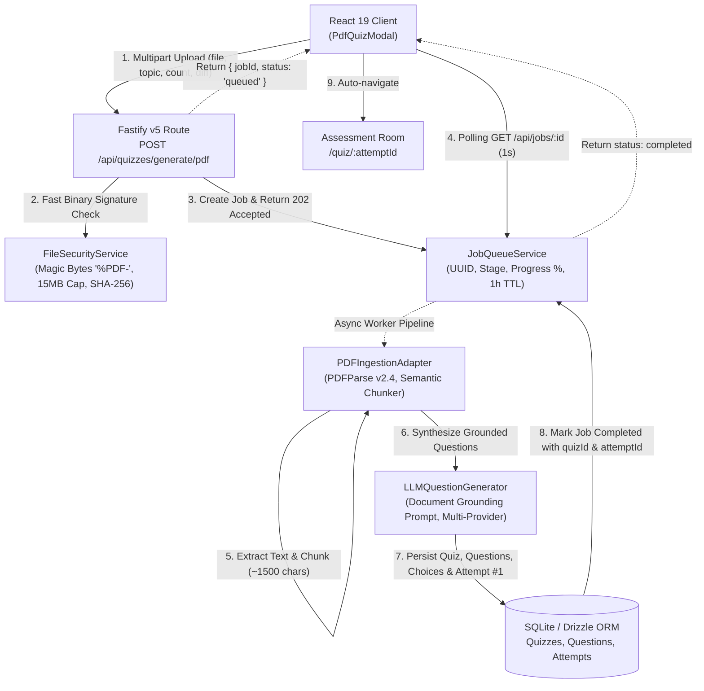

# Milestone 3 Completion Report: Unified Ingestion Core & PDF-to-Quiz

## Executive Summary

Milestone 3 of the **QuizForge** production evolution has been fully implemented, verified, and integrated. This milestone establishes the **Canonical Ingestion & Normalization Core**, robust binary security validation, an **Asynchronous Job Processing Queue** with real-time stage tracking, and full end-to-end **PDF-to-Quiz generation**.

All 101 tests across 12 test suites are passing with zero regressions, and full TypeScript typechecks and production bundles (`vite build` & `tsc`) succeed cleanly.

---

## Architecture & Implementation Details



### 1. Canonical Document Schema (`@quiz-forge/shared`)
- **[document.schema.ts](file:///E:/Personal%20projects/Quiz%20Application/packages/shared/src/schemas/document.schema.ts)** defines universal contracts for all ingestion pipelines:
  - `NormalizedDocument`: standardized representation containing `id`, `sourceType`, `sourceIdentifier`, `title`, `metadata` (checksum, page count, byte size), and `chunks`.
  - `DocumentChunk`: semantic slices of content with token estimations and order indexing.
  - `JobResult` & `JobStage`: tracking state machine (`queued -> validating_file -> extracting_text -> chunking -> synthesizing_questions -> completed / failed`).
  - `GeneratePdfQuizOptions`: validation schema for PDF-generation parameters.

### 2. File Security & Ingestion Pipeline
- **[file-security.service.ts](file:///E:/Personal%20projects/Quiz%20Application/apps/backend/src/services/ingestion/file-security.service.ts)**:
  - **Magic Bytes Validation**: Verifies the first 5 binary bytes strictly match `0x25, 0x50, 0x44, 0x46, 0x2d` (`%PDF-`), rejecting spoofed files or disguised binaries before parsing.
  - **File Size Cap**: Enforces an explicit 15 MB boundary.
  - **Checksum Generation**: Calculates SHA-256 cryptographic digest for deduplication and audit logging.
- **[pdf.adapter.ts](file:///E:/Personal%20projects/Quiz%20Application/apps/backend/src/services/ingestion/pdf.adapter.ts)**:
  - Employs modern `PDFParse` ESM parsing with automatic buffer-to-typed-array conversion.
  - Strips unprintable control characters and normalizes Unicode line breaks.
  - Enforces minimum extracted text threshold (50 chars) to detect empty or scanned image documents without readable text layers.
  - Performs semantic paragraph-based chunking (~1,500 characters per chunk) and token budgeting.

### 3. Asynchronous Job Processing Queue
- **[job-queue.service.ts](file:///E:/Personal%20projects/Quiz%20Application/apps/backend/src/services/jobs/job-queue.service.ts)**:
  - In-memory async job registry with auto-expiration (1-hour TTL sweep).
  - Multi-tenant security guard: prevents unauthorized users from polling jobs created by other tenants.
  - Progress updates with percentage (0–100%) and descriptive human-readable stage messages.
- **[job.routes.ts](file:///E:/Personal%20projects/Quiz%20Application/apps/backend/src/routes/job.routes.ts)**:
  - Protected endpoint `GET /api/jobs/:id` for live polling.

### 4. Grounded AI Synthesis & Multi-Provider Integration
- **[pdf-quiz.service.ts](file:///E:/Personal%20projects/Quiz%20Application/apps/backend/src/services/pdf-quiz.service.ts)**:
  - Orchestrates background processing: extracts text, chunks document, constrains context window (~10,000 chars / ~2,500 tokens) to prevent rate limits / token overflow on providers like Groq.
  - Injects source excerpts into `LLMQuestionGenerator` with strict anti-hallucination grounding prompts.
  - Persists quiz, questions, choices, and initializes `quizAttempts` attempt #1 with Fisher-Yates shuffled sequence in a single ACID transaction.
- **[pdf-quiz.routes.ts](file:///E:/Personal%20projects/Quiz%20Application/apps/backend/src/routes/pdf-quiz.routes.ts)**:
  - Consumes multipart uploads via `@fastify/multipart` streaming parser.
  - Responds immediately with HTTP 202 Accepted and tracking `jobId`.

### 5. Frontend PDF Upload & Live Job Tracker
- **[PdfQuizModal.tsx](file:///E:/Personal%20projects/Quiz%20Application/apps/frontend/src/components/quiz/PdfQuizModal.tsx)**:
  - Drag-and-drop dropzone with file type (.pdf) and size validation.
  - Title override, question count selector (3, 5, 10, 15), difficulty selector, and AI engine selector (Groq, NVIDIA NIM, Gemini).
  - Animated live progress stepper with progress bar and stage status.
  - Auto-navigation to the quiz assessment room upon job completion.
- **[DashboardPage.tsx](file:///E:/Personal%20projects/Quiz%20Application/apps/frontend/src/pages/DashboardPage.tsx)**:
  - Added dedicated "PDF to Quiz" card to the dashboard grid with rose visual accents.
- **[client.ts](file:///E:/Personal%20projects/Quiz%20Application/apps/frontend/src/api/client.ts)**:
  - Added `postFormData` helper to handle multipart/form-data with HTTP-Only cookies.

---

## Verification & Automated Test Results

### Automated Test Suite: 101 Passing Tests
```
 ✓ src/test/github-service.test.ts (13 tests)
 ✓ src/test/llm-providers.test.ts (14 tests)
 ✓ src/test/ai.test.ts (8 tests)
 ✓ src/test/db.test.ts (6 tests)
 ✓ src/test/health.test.ts (1 test)
 ✓ src/test/code-quiz.test.ts (2 tests)
 ✓ src/test/security.test.ts (7 tests)
 ✓ src/test/quiz-engine.test.ts (8 tests)
 ✓ src/test/e2e-lifecycle.test.ts (7 tests)
 ✓ src/test/classroom.test.ts (17 tests)
 ✓ src/test/pdf-quiz.test.ts (7 tests)
 ✓ src/test/auth.test.ts (11 tests)

 Test Files  12 passed (12)
      Tests  101 passed (101)
```

### Typechecking & Production Bundles
- `@quiz-forge/shared`: `tsc` clean (0 errors)
- `@quiz-forge/backend`: `tsc --noEmit` clean (0 errors)
- `@quiz-forge/frontend`: `tsc --noEmit` & `vite build` clean (0 errors)

---

## Next Steps: Milestone 4 (URL-to-Quiz Ingestion with SSRF Defense)

1. **SSRF Defense Engine**: DNS pre-lookup, blacklisting IPv4 loopback (`127.0.0.0/8`), private RFC1918 subnets (`10.0.0.0/8`, `172.16.0.0/12`, `192.168.0.0/16`), link-local (`169.254.0.0/16`), AWS metadata (`169.254.169.254`), and IPv6 loopback (`::1`).
2. **HTML Extraction & Readability Normalizer**: Clean HTML content extraction using Readability / Cheerio.
3. **URL Quiz Ingestion Route & UI**: Async job queue integration for URL analysis with source attribution.
