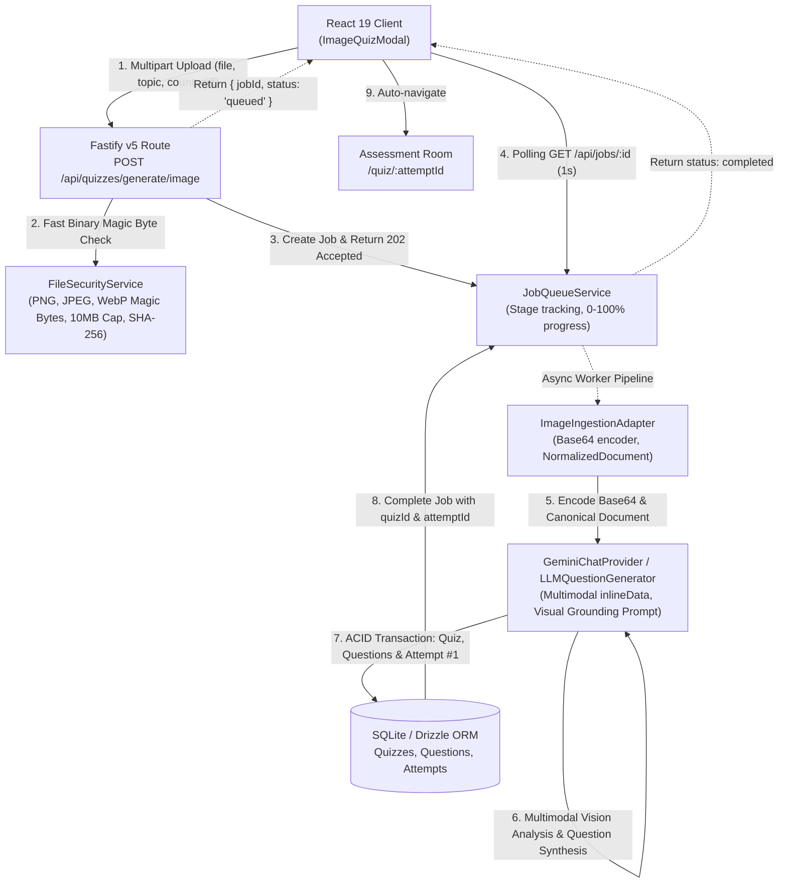

# Milestone 5 Completion Report: Image-to-Quiz with Vision Processing

## Executive Summary

Milestone 5 of the **QuizForge** production evolution has been fully implemented, verified, and integrated. This milestone delivers a comprehensive **Image-to-Quiz Ingestion Pipeline** powered by **Multimodal Vision AI Processing**, strict image binary security verification (PNG, JPEG, WebP magic bytes), an asynchronous background processing pipeline, and an interactive UI modal with live thumbnail preview.

All **122 automated tests across 14 test suites** pass cleanly with zero regressions, and full workspace TypeScript typechecks and production builds (`vite build` & `tsc`) succeed without errors.

---

## Architecture & Implementation Details



### 1. Image Binary Security & Signature Verification
- **[file-security.service.ts](file:///E:/Personal%20projects/Quiz%20Application/apps/backend/src/services/ingestion/file-security.service.ts)**:
  - **Magic Byte Validation**: Verifies binary headers strictly before any buffer processing:
    - **PNG**: `0x89, 0x50, 0x4E, 0x47, 0x0D, 0x0A, 0x1A, 0x0A`
    - **JPEG**: `0xFF, 0xD8, 0xFF`
    - **WebP**: `RIFF` at bytes 0..4 and `WEBP` at bytes 8..12
  - **Size Cap**: Enforces a 10 MB maximum boundary.
  - **MIME Detection & Checksum**: Returns verified MIME type (`image/png`, `image/jpeg`, `image/webp`) and calculates cryptographic SHA-256 digest.

### 2. Multimodal Vision Provider Integration
- **[image.adapter.ts](file:///E:/Personal%20projects/Quiz%20Application/apps/backend/src/services/ingestion/image.adapter.ts)**:
  - Base64 encodes valid image buffers and outputs canonical `NormalizedDocument` (`sourceType: 'image'`).
- **[llm.interface.ts](file:///E:/Personal%20projects/Quiz%20Application/apps/backend/src/services/llm/llm.interface.ts)** & **[gemini-chat.provider.ts](file:///E:/Personal%20projects/Quiz%20Application/apps/backend/src/services/llm/gemini-chat.provider.ts)**:
  - Extended LLM interface with `ImageAttachment` (`base64`, `mimeType`).
  - Google Gemini integration constructs native multimodal payloads via `parts: [{ text: prompt }, { inlineData: { mimeType, data } }]`.
- **[prompts.ts](file:///E:/Personal%20projects/Quiz%20Application/apps/backend/src/services/ai/prompts.ts)**:
  - Injects anti-hallucination visual grounding rules: requires all questions, choices, and explanations to be directly supported by labels, relationships, and concepts visible in the uploaded image.

### 3. Asynchronous Job & Database Persistence
- **[image-quiz.service.ts](file:///E:/Personal%20projects/Quiz%20Application/apps/backend/src/services/image-quiz.service.ts)**:
  - Synchronously validates image format, immediately returns `202 Accepted` with tracking `jobId`.
  - Non-blocking background stages: `validating_file` (15%) $\to$ `analyzing_image` (40%) $\to$ `synthesizing_questions` (75%) $\to$ `completed` (100%).
  - Atomically records quiz, questions, choices, and initializes `quizAttempts` attempt #1 with Fisher-Yates shuffled question order.
- **[image-quiz.routes.ts](file:///E:/Personal%20projects/Quiz%20Application/apps/backend/src/routes/image-quiz.routes.ts)**:
  - Streaming multipart route registered at `POST /api/quizzes/generate/image`.

### 4. Frontend Vision Modal & Dashboard Integration
- **[ImageQuizModal.tsx](file:///E:/Personal%20projects/Quiz%20Application/apps/frontend/src/components/quiz/ImageQuizModal.tsx)**:
  - Drag-and-drop dropzone for PNG, JPEG, and WebP images.
  - Live preview thumbnail with size indicator.
  - Question count presets (3, 5, 10, 15), difficulty selector, and AI engine selector (Gemini 2.5 Flash, NVIDIA NIM, Groq).
  - Live job tracking stepper with progress bar and auto-navigation to `/quiz/:attemptId`.
- **[DashboardPage.tsx](file:///E:/Personal%20projects/Quiz%20Application/apps/frontend/src/pages/DashboardPage.tsx)**:
  - Integrated "Image to Quiz" card with violet styling into the dashboard grid.

---

## Verification & Automated Test Results

### Automated Test Suite: 122 Passing Tests
```
 ✓ src/test/github-service.test.ts (13 tests)
 ✓ src/test/llm-providers.test.ts (14 tests)
 ✓ src/test/ai.test.ts (8 tests)
 ✓ src/test/db.test.ts (6 tests)
 ✓ src/test/health.test.ts (1 test)
 ✓ src/test/code-quiz.test.ts (2 tests)
 ✓ src/test/security.test.ts (7 tests)
 ✓ src/test/url-quiz.test.ts (13 tests)
 ✓ src/test/image-quiz.test.ts (8 tests)
 ✓ src/test/classroom.test.ts (17 tests)
 ✓ src/test/pdf-quiz.test.ts (7 tests)
 ✓ src/test/auth.test.ts (11 tests)
 ✓ src/test/e2e-lifecycle.test.ts (7 tests)
 ✓ src/test/quiz-engine.test.ts (8 tests)

 Test Files  14 passed (14)
      Tests  122 passed (122)
```

### Typechecking & Production Bundles
- `@quiz-forge/shared`: `tsc` clean (0 errors)
- `@quiz-forge/backend`: `tsc --noEmit` clean (0 errors)
- `@quiz-forge/frontend`: `tsc --noEmit` & `vite build` clean (0 errors)

---

## Next Steps: Milestone 6 (Quiz Review Studio & Publishing Engine)

1. **Human-in-the-Loop Review Studio**: Allow creators (teachers, students, quiz authors) to review AI-generated questions before publishing or sharing:
   - Edit question text, choice texts, correct answer ID, and explanations.
   - Delete irrelevant or hallucinated questions.
   - Add custom manual questions.
   - Reorder question sequence.
2. **Draft & Published State Machine**: Introduce `isPublished` or `status: 'draft' | 'published'` in `quizzes` table with Drizzle migration.
3. **Sharing & Discovery**: Generate shareable public quiz links and classroom assignment integration.
