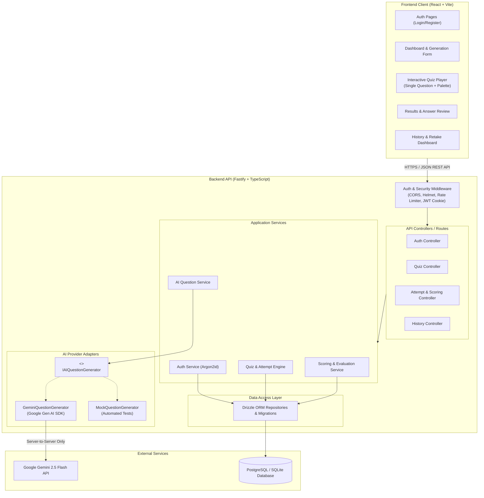
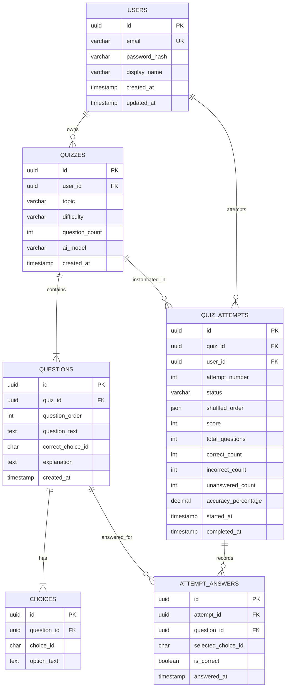

# Phase 0: System Architecture & Engineering Blueprint
## QuizForge — AI-Powered MCQ Quiz Platform

---

### Executive Summary

**QuizForge** is an enterprise-grade full-stack web application that allows authenticated users to dynamically generate, attempt, review, and restart AI-generated multiple-choice quizzes powered by Google Gemini.

This document establishes the Phase 0 architectural foundation, database design, API contracts, security standards, and implementation roadmap. No application code will be executed until this proposal is reviewed and approved.

---

## 1. Repository Discovery & Current State

- **Workspace Path:** `E:\Personal projects\Quiz Application`
- **Initial State:** Empty directory (no existing files, package managers, or Git repositories).
- **Available Runtimes & Tooling:**
  - **Node.js:** `v22.23.4` (LTS)
  - **Package Managers:** `pnpm` (`11.22.0`), `npm` (`11.16.0`)
  - **Python:** `3.13.1`
  - **Docker:** `29.7.2`
  - **Git:** `2.47.0.windows.1`

Because the repository is clean, we have complete architectural freedom to implement a clean-slate, modern, and type-safe architecture optimized for maintainability and scalability.

---

## 2. Technology Stack Recommendation

We recommend a **TypeScript Monorepo (pnpm workspaces)** separating the backend API service and the frontend client application, sharing common TypeScript types and validation schemas.

| Layer | Technology | Justification |
| :--- | :--- | :--- |
| **Monorepo / Workspace** | **pnpm workspaces** | High-speed, disk-efficient dependency deduplication, strict dependency isolation between packages. |
| **Backend Framework** | **Node.js 22 + Fastify (TypeScript)** | Exceptionally fast, low-overhead HTTP framework with built-in schema validation, encapsulation plugins, and rock-solid request lifecycle hooks. |
| **Frontend Framework** | **React 19 + Vite (TypeScript)** | Instant HMR, minimal bundle size, pure client-side SPA with React Router v7. Completely isolates secrets from the client. |
| **Styling & UI Components**| **Tailwind CSS + Lucide Icons + Radix UI / shadcn patterns** | Accessible, responsive design system. Allows crafting polished question palettes, progress bars, and modal dialogues. |
| **Database & ORM** | **PostgreSQL (via Docker) with SQLite support, managed by Drizzle ORM** | Type-safe SQL dialect, zero-overhead queries, automated migrations via `drizzle-kit`, and easy dialect switching between SQLite (local dev option) and PostgreSQL (production). |
| **AI Integration** | **Google Gen AI SDK (`@google/genai`)** | Server-side provider adapter with JSON Schema enforcement (`responseSchema`), structured outputs, retry policies, and timeout handling. |
| **Data Validation** | **Zod (shared between client and server)** | Single source of truth for runtime validation of API payloads, Gemini generation responses, and database inputs. |
| **Authentication** | **JWT with HTTP-Only SameSite Secure Cookies + Argon2id** | Cryptographically secure, stateless authentication immune to client-side XSS token theft. |
| **Testing Harness** | **Vitest + Supertest (Backend), Vitest + React Testing Library (Frontend)** | Fast unit, integration, and mocking framework sharing configurations across the monorepo. |

---

## 3. High-Level System Architecture



---

## 4. Database Design (Entity-Relationship)

### Database Relationships

- **Users to Quizzes (1 : N):** A user owns generated quizzes. Deleting a user cascades to all their quizzes.
- **Quizzes to Questions (1 : N):** A quiz contains ordered questions. Deleting a quiz cascades to all its questions.
- **Questions to Choices (1 : 4):** Each question has exactly 4 choices ('A', 'B', 'C', 'D').
- **Quizzes to QuizAttempts (1 : N):** A quiz can be attempted multiple times (Attempt 1 on generation, Attempt 2+ on restart).
- **Users to QuizAttempts (1 : N):** Direct ownership link ensuring users only access their own attempts.
- **QuizAttempts to AttemptAnswers (1 : N):** Records the user's selected choice for each question in an attempt.



### Table Definitions & Constraints

1. **`users`**
   - `id`: UUID PRIMARY KEY (gen_random_uuid())
   - `email`: VARCHAR(255) NOT NULL UNIQUE (indexed, lowercase)
   - `password_hash`: VARCHAR(255) NOT NULL (Argon2id)
   - `display_name`: VARCHAR(100) NOT NULL
   - `created_at`, `updated_at`: TIMESTAMP WITH TIME ZONE NOT NULL

2. **`quizzes`**
   - `id`: UUID PRIMARY KEY
   - `user_id`: UUID NOT NULL REFERENCES `users(id)` ON DELETE CASCADE
   - `topic`: VARCHAR(255) NOT NULL
   - `difficulty`: VARCHAR(20) NOT NULL CHECK (`difficulty IN ('easy', 'medium', 'hard', 'mixed')`)
   - `question_count`: INT NOT NULL CHECK (`question_count BETWEEN 1 AND 50`)
   - `ai_model`: VARCHAR(100) NOT NULL DEFAULT 'gemini-2.5-flash'
   - `created_at`: TIMESTAMP WITH TIME ZONE NOT NULL
   - *Indexes:* `(user_id, created_at DESC)`

3. **`questions`**
   - `id`: UUID PRIMARY KEY
   - `quiz_id`: UUID NOT NULL REFERENCES `quizzes(id)` ON DELETE CASCADE
   - `question_order`: INT NOT NULL
   - `question_text`: TEXT NOT NULL
   - `correct_choice_id`: CHAR(1) NOT NULL CHECK (`correct_choice_id IN ('A', 'B', 'C', 'D')`)
   - `explanation`: TEXT NOT NULL
   - `created_at`: TIMESTAMP WITH TIME ZONE NOT NULL
   - *Constraints:* UNIQUE(`quiz_id`, `question_order`), INDEX(`quiz_id`)

4. **`choices`**
   - `id`: UUID PRIMARY KEY
   - `question_id`: UUID NOT NULL REFERENCES `questions(id)` ON DELETE CASCADE
   - `choice_id`: CHAR(1) NOT NULL CHECK (`choice_id IN ('A', 'B', 'C', 'D')`)
   - `option_text`: TEXT NOT NULL
   - *Constraints:* UNIQUE(`question_id`, `choice_id`), INDEX(`question_id`)

5. **`quiz_attempts`**
   - `id`: UUID PRIMARY KEY
   - `quiz_id`: UUID NOT NULL REFERENCES `quizzes(id)` ON DELETE CASCADE
   - `user_id`: UUID NOT NULL REFERENCES `users(id)` ON DELETE CASCADE
   - `attempt_number`: INT NOT NULL (1 for initial, 2+ for restarts)
   - `status`: VARCHAR(20) NOT NULL CHECK (`status IN ('in_progress', 'completed', 'abandoned')`)
   - `shuffled_order`: JSONB / TEXT NOT NULL (ordered array of `question_id`s representing the randomized question presentation order for this specific attempt)
   - `score`: INT NULL
   - `total_questions`: INT NOT NULL
   - `correct_count`: INT NULL
   - `incorrect_count`: INT NULL
   - `unanswered_count`: INT NULL
   - `accuracy_percentage`: NUMERIC(5, 2) NULL
   - `started_at`: TIMESTAMP WITH TIME ZONE NOT NULL DEFAULT NOW()
   - `completed_at`: TIMESTAMP WITH TIME ZONE NULL
   - *Constraints:* UNIQUE(`quiz_id`, `attempt_number`), INDEX(`user_id`, `completed_at DESC`)

6. **`attempt_answers`**
   - `id`: UUID PRIMARY KEY
   - `attempt_id`: UUID NOT NULL REFERENCES `quiz_attempts(id)` ON DELETE CASCADE
   - `question_id`: UUID NOT NULL REFERENCES `questions(id)` ON DELETE CASCADE
   - `selected_choice_id`: CHAR(1) NULL CHECK (`selected_choice_id IN ('A', 'B', 'C', 'D')`)
   - `is_correct`: BOOLEAN NULL
   - `answered_at`: TIMESTAMP WITH TIME ZONE NOT NULL DEFAULT NOW()
   - *Constraints:* UNIQUE(`attempt_id`, `question_id`), INDEX(`attempt_id`)

---

## 5. Question Data Contract & AI Pipeline

### Logical AI Response Schema (Gemini Generation)
When calling Gemini, we use **Structured JSON Outputs** (`responseMimeType: "application/json"`, with `responseSchema` defined).

```json
{
  "questions": [
    {
      "question_id": "q_001",
      "question": "What is the primary function of the mitochondria in eukaryotic cells?",
      "choices": [
        { "choice_id": "A", "option_text": "Lipid synthesis and storage" },
        { "choice_id": "B", "option_text": "Cellular respiration and ATP generation" },
        { "choice_id": "C", "option_text": "Protein folding and packaging" },
        { "choice_id": "D", "option_text": "DNA replication during cell division" }
      ],
      "correct_answer_id": "B",
      "explanation": "Mitochondria generate most of the chemical energy needed to power the biochemical reactions through ATP production."
    }
  ]
}
```

### Strict Validation Rules (Zod Enforcement):
1. Number of generated items must match `requested_count` exactly.
2. Each question text must be distinct (no duplicate questions).
3. Choices must contain exactly 4 options with unique `choice_id`s `['A', 'B', 'C', 'D']`.
4. Option texts must be non-empty and unique per question (no duplicate answers).
5. `correct_answer_id` must match one of `['A', 'B', 'C', 'D']`.
6. Explanation must be non-empty and clear.

### Client-Facing Security Rule:
- When a user is taking a quiz, `GET /api/attempts/:id` delivers **only sanitized questions**:
  ```json
  {
    "question_id": "f47ac10b-58cc-4372-a567-0e02b2c3d479",
    "question": "What is the primary function of the mitochondria in eukaryotic cells?",
    "choices": [
      { "choice_id": "A", "option_text": "Lipid synthesis and storage" },
      { "choice_id": "B", "option_text": "Cellular respiration and ATP generation" },
      { "choice_id": "C", "option_text": "Protein folding and packaging" },
      { "choice_id": "D", "option_text": "DNA replication during cell division" }
    ]
  }
  ```
- **`correct_answer_id` and `explanation` are NEVER sent to the client during an in-progress attempt.**
- Only after submission via `POST /api/attempts/:id/submit` are the evaluation, correct answers, and explanations revealed.

---

## 6. API Specification

All protected endpoints require a valid session/JWT cookie and strictly enforce user ownership.

### Authentication Endpoints
- `POST /api/auth/register`
  - Body: `{ email, password, displayName }`
  - Returns: `{ user: { id, email, displayName } }` (Sets HTTP-Only auth cookie)
- `POST /api/auth/login`
  - Body: `{ email, password }`
  - Returns: `{ user: { id, email, displayName } }` (Sets HTTP-Only auth cookie)
- `POST /api/auth/logout`
  - Clears auth cookie
- `GET /api/auth/me`
  - Returns: `{ user: { id, email, displayName } }`

### Quiz & Generation Endpoints
- `POST /api/quizzes/generate`
  - Body: `{ topic: string, questionCount: number, difficulty: "easy" | "medium" | "hard" | "mixed" }`
  - Operation: Calls Gemini adapter, validates schema, persists `quizzes`, `questions`, and `choices`, creates Attempt #1 with randomized order.
  - Returns: `{ quizId, attemptId, totalQuestions, status: "in_progress" }`
- `GET /api/quizzes/:quizId`
  - Returns metadata for a quiz (topic, difficulty, question count, creation date, attempts count).
- `POST /api/quizzes/:quizId/restart`
  - Operation: Fetches existing questions from DB (zero Gemini calls), computes new shuffled order, creates Attempt #(N+1), resets answers.
  - Returns: `{ attemptId, quizId, totalQuestions, status: "in_progress" }`

### Quiz Attempt & Scoring Endpoints
- `GET /api/attempts/:attemptId`
  - Returns sanitized attempt state:
    ```json
    {
      "attemptId": "...",
      "quizId": "...",
      "topic": "...",
      "difficulty": "...",
      "status": "in_progress",
      "totalQuestions": 10,
      "questions": [ /* Sanitized questions in attempt's shuffled order */ ],
      "savedAnswers": { "question_id_1": "B", "question_id_2": "A" }
    }
    ```
- `PATCH /api/attempts/:attemptId/answers`
  - Body: `{ questionId: string, selectedChoiceId: "A" | "B" | "C" | "D" | null }`
  - Autosaves the user's selection immediately. Idempotent upsert.
- `POST /api/attempts/:attemptId/submit`
  - Operation: Finalizes attempt. Computes server-side correctness for all questions. Calculates score, accuracy, correct count, incorrect count, unanswered count. Updates attempt status to `completed`.
  - Returns complete score breakdown and answer review payload.
- `GET /api/attempts/:attemptId/results`
  - Returns full results for a completed attempt, including answer-by-answer review with explanations.

### History Endpoints
- `GET /api/history`
  - Query params: `page`, `limit`
  - Returns paginated list of user's past attempts:
    ```json
    {
      "attempts": [
        {
          "attemptId": "...",
          "quizId": "...",
          "topic": "...",
          "difficulty": "...",
          "score": 8,
          "totalQuestions": 10,
          "accuracyPercentage": 80.00,
          "completedAt": "2026-11-21T00:00:00Z",
          "attemptNumber": 1
        }
      ],
      "pagination": { "total": 12, "page": 1, "pageSize": 10 }
    }
    ```

---

## 7. Folder Structure

```text
quiz-forge/
├── .env.example
├── .gitignore
├── pnpm-workspace.yaml
├── package.json
├── packages/
│   └── shared/                      # Shared types, Zod schemas, data contracts
│       ├── package.json
│       ├── tsconfig.json
│       └── src/
│           ├── index.ts
│           ├── schemas/             # Zod schemas (auth, quiz, attempt, ai)
│           └── types/               # TypeScript interfaces
├── apps/
│   ├── backend/                     # Fastify API Server
│   │   ├── package.json
│   │   ├── tsconfig.json
│   │   ├── drizzle.config.ts
│   │   ├── src/
│   │   │   ├── server.ts
│   │   │   ├── config/              # Validated environment variables (Zod)
│   │   │   ├── db/                  # Drizzle schema, client, migrations
│   │   │   │   ├── schema/
│   │   │   │   ├── migrations/
│   │   │   │   └── index.ts
│   │   │   ├── plugins/             # Fastify plugins (auth, error-handler, cors)
│   │   │   ├── routes/              # Route handlers
│   │   │   │   ├── auth.routes.ts
│   │   │   │   ├── quiz.routes.ts
│   │   │   │   ├── attempt.routes.ts
│   │   │   │   └── history.routes.ts
│   │   │   ├── services/            # Business logic
│   │   │   │   ├── auth.service.ts
│   │   │   │   ├── quiz.service.ts
│   │   │   │   ├── scoring.service.ts
│   │   │   │   └── ai/              # AI abstraction layer
│   │   │   │       ├── ai.interface.ts
│   │   │   │       ├── gemini.provider.ts
│   │   │   │       └── mock.provider.ts
│   │   │   └── test/                # Unit & Integration tests
│   │   └── ...
│   └── frontend/                    # React 19 + Vite SPA
│       ├── package.json
│       ├── tsconfig.json
│       ├── vite.config.ts
│       ├── index.html
│       └── src/
│           ├── main.tsx
│           ├── App.tsx
│           ├── api/                 # Typed API client (Axios / Fetch with credentials)
│           ├── components/          # Reusable UI components
│           │   ├── ui/              # Buttons, Cards, Dialogs, Badges
│           │   ├── layout/          # Navbar, ProtectedRoute, Shell
│           │   └── quiz/            # QuestionCard, OptionList, QuestionPalette, ProgressBar
│           ├── hooks/               # useAuth, useQuizAttempt, useAutosave
│           ├── pages/               # Route views
│           │   ├── LoginPage.tsx
│           │   ├── RegisterPage.tsx
│           │   ├── DashboardPage.tsx
│           │   ├── QuizPlayerPage.tsx
│           │   ├── QuizResultsPage.tsx
│           │   └── HistoryPage.tsx
│           └── test/                # Component & Player tests
```

---

## 8. Security Considerations

1. **API Key Isolation:**
   - The `GEMINI_API_KEY` is loaded exclusively on the backend via validated server environment variables (`config.ts`).
   - Vite is configured to never bundle or expose server variables (`VITE_` prefix enforcement).
2. **Cheat Prevention (Anti-Tampering):**
   - Correct answer IDs and explanations are omitted from all quiz player endpoints.
   - Quiz score is strictly calculated server-side by matching submitted answers against database records.
   - Questions answered after attempt completion are rejected.
3. **Authorization & Multi-Tenancy:**
   - Every database query for quizzes, attempts, and answers includes `WHERE user_id = :currentUser`.
   - Accessing another user's quiz attempt returns an immediate `403 Forbidden` / `404 Not Found`.
4. **Credential Security:**
   - Passwords hashed using Argon2id with recommended memory and iteration cost parameters.
   - Authentication tokens stored in `HttpOnly`, `SameSite=Strict`, `Secure` cookies.
5. **Rate Limiting & Abuse Prevention:**
   - Gemini generation endpoints are rate-limited per user (e.g. max 5 quiz generations per minute) to prevent quota exhaustion and API abuse.
6. **Input & Output Validation:**
   - Every request body is validated with strict Zod schemas.
   - Gemini outputs are parsed and validated with Zod before database insertion.

---

## 9. Phased Implementation Roadmap

Every milestone is approval-gated.

- **Phase 0: Discovery & System Planning (Current Phase)**
  - Repository audit, tech stack recommendation, system architecture, database ERD, API specs, security blueprint.
- **Phase 1: Project Setup, Monorepo Scaffolding & Database Migrations**
  - pnpm workspace setup, TypeScript config, Fastify & React skeleton, Drizzle ORM database connection & initial migration scripts.
- **Phase 2: Authentication & Authorization Engine**
  - Argon2id password hashing, JWT HTTP-Only cookie system, Auth endpoints, React Auth context, protected route guards, and auth unit/integration tests.
- **Phase 3: AI Provider Adapter & Gemini Integration**
  - `IAIQuestionGenerator` abstraction, `GeminiQuestionGenerator` with JSON Schema structured outputs, fallback logic, Zod validation, retry mechanism, and mock tests.
- **Phase 4: Core Quiz Engine & Scoring Backend**
  - Quiz persistence, Attempt lifecycle management, restart with Fisher-Yates question shuffling, answer autosave endpoint, server-side scoring algorithm, and history queries.
- **Phase 5: Interactive Quiz Player & Generation UI**
  - Dashboard quiz generation form, interactive player interface (single question view, option selection, Previous/Next navigation, responsive Question Navigation Palette, progress indicators, submission modal).
- **Phase 6: Results, Review, History & Retake Flow**
  - Score summary cards, answer-by-answer breakdown with explanations, history table/dashboard, seamless "Restart Quiz" and "New Quiz" workflows.
- **Phase 7: End-to-End Testing, Security Hardening & Production Polish**
  - Full automated test suite (mocking Gemini), edge case handling (network blips, unanswered questions, rate limits), responsive styling polish, production build verification.
