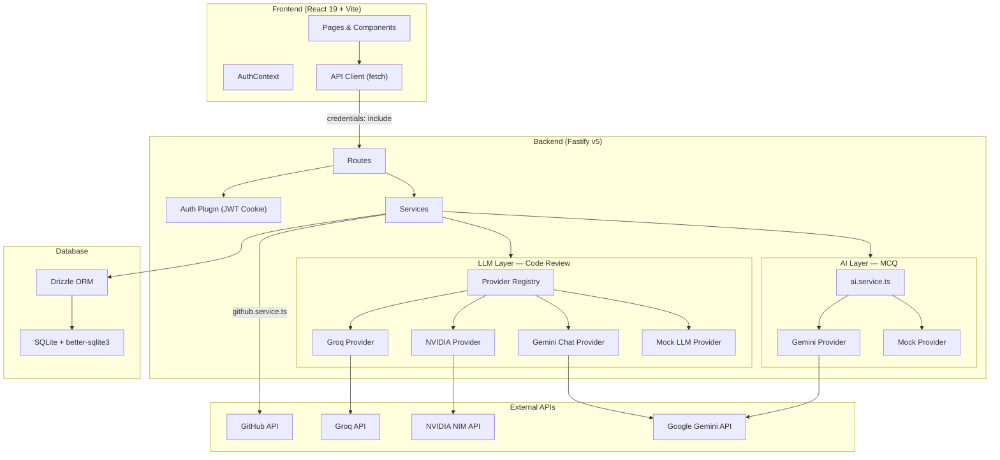
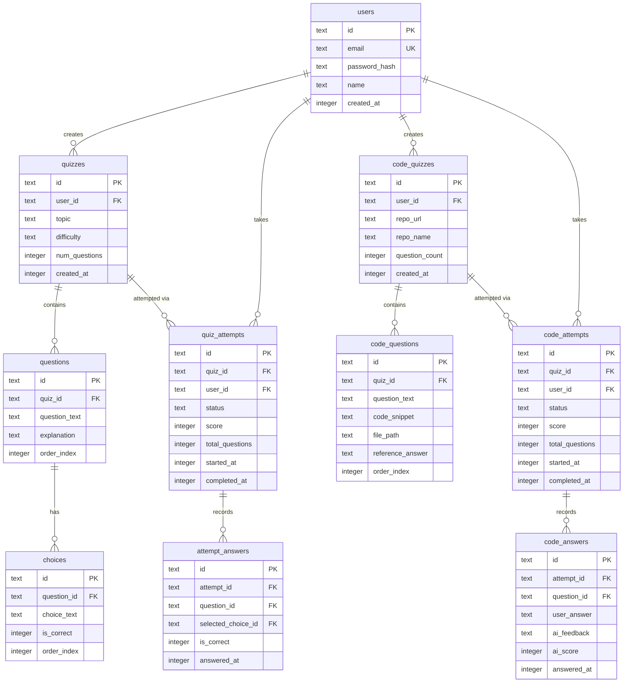
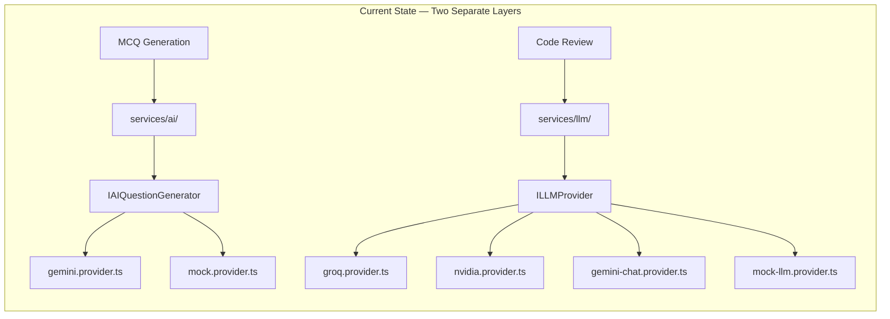
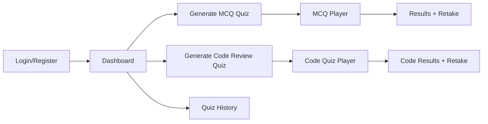
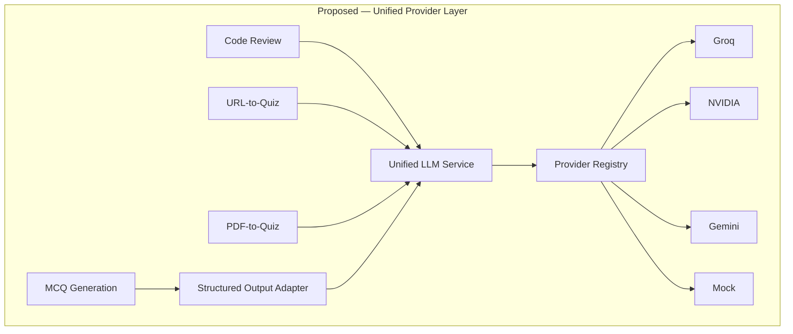
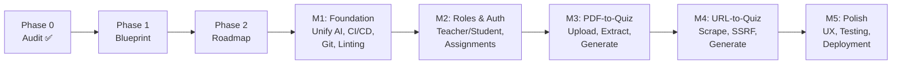

# QuizForge — Phase 0: Repository & Product Audit

> **Audit Date:** 2026-11-22  
> **Auditor:** Antigravity (Claude Opus 4.6)  
> **Scope:** Read-only audit — zero code changes were made  
> **Methodology:** Every source file in the repository was read. All validation commands were re-run.

---

## Validation Status

| Check | Result | Details |
|---|---|---|
| `pnpm typecheck` | ✅ **PASS** | 0 errors across 3 packages (shared, backend, frontend) |
| `pnpm test` | ✅ **PASS** | **73/73 tests**, 10 test suites, 25.67s execution |
| `pnpm build` | ✅ **PASS** | Frontend: 384.50 kB JS → 106.02 kB gzipped |
| Infinite-fetch fix | ✅ **INTACT** | `CodeQuizPlayerPage.tsx` uses `useRef` + `useCallback` with deps `[attemptId, storageKey]` — `attempt` is correctly excluded |

> [!IMPORTANT]
> Git is initialized but has **zero commits**. All files show as untracked (`??`). An initial commit should be made before any further development.

---

## 1. Architecture Overview

### 1.1 Project Structure

```
Quiz Application/                    # pnpm monorepo workspace
├── apps/
│   ├── backend/                     # Fastify v5 API server
│   │   ├── src/
│   │   │   ├── config/env.ts        # Zod-validated environment
│   │   │   ├── db/                  # Drizzle ORM + better-sqlite3
│   │   │   ├── plugins/             # Fastify auth plugin
│   │   │   ├── routes/              # 6 route modules
│   │   │   ├── services/            # Business logic
│   │   │   │   ├── ai/              # MCQ generation (Gemini-only)
│   │   │   │   └── llm/             # Code review (multi-provider)
│   │   │   └── utils/               # Auth helpers, captcha, shuffle
│   │   └── test/                    # 10 test suites (73 tests)
│   └── frontend/                    # React 19 + Vite + Tailwind CSS
│       └── src/
│           ├── api/                 # Fetch wrapper
│           ├── components/          # UI components
│           ├── context/             # Auth context
│           ├── hooks/               # Quiz attempt hook
│           └── pages/               # 7 page components
├── packages/
│   └── shared/                      # Zod schemas + TypeScript types
├── package.json                     # Workspace root
├── pnpm-workspace.yaml
└── tsconfig.base.json               # Shared TS config (ES2022, strict)
```

### 1.2 Architecture Diagram



### 1.3 Data Model



### 1.4 Technology Stack

| Layer | Technology | Version |
|---|---|---|
| Runtime | Node.js | (project requires ES2022) |
| Package Manager | pnpm | Workspaces |
| Language | TypeScript | Strict mode, Bundler resolution |
| Backend Framework | Fastify | v5 |
| ORM | Drizzle ORM | — |
| Database | SQLite | better-sqlite3, WAL mode |
| Frontend Framework | React | 19 |
| Build Tool | Vite | 6.4.6 |
| CSS | Tailwind CSS | — |
| Validation | Zod | Shared schemas across frontend/backend |
| Auth | jose (JWT) + bcryptjs | HS256, 12 salt rounds |
| Testing | Vitest | v3.2.7 |
| AI/LLM | Gemini, Groq, NVIDIA NIM | Multi-provider with fallback |

---

## 2. Working Functionality Inventory

### ✅ Fully Working & Verified

| Feature | Evidence | Files |
|---|---|---|
| **User Registration** | 73/73 tests pass, auth tests cover registration | [auth.service.ts](file:///E:/Personal%20projects/Quiz%20Application/apps/backend/src/services/auth.service.ts), [auth.routes.ts](file:///E:/Personal%20projects/Quiz%20Application/apps/backend/src/routes/auth.routes.ts) |
| **User Login** | Cookie-based JWT, HttpOnly, SameSite=strict | [auth.plugin.ts](file:///E:/Personal%20projects/Quiz%20Application/apps/backend/src/plugins/auth.plugin.ts), [token.ts](file:///E:/Personal%20projects/Quiz%20Application/apps/backend/src/utils/token.ts) |
| **Math CAPTCHA on Login** | HMAC-SHA256 challenge/response | [captcha.ts](file:///E:/Personal%20projects/Quiz%20Application/apps/backend/src/utils/captcha.ts) |
| **MCQ Quiz Generation** | AI-generated from topic + difficulty, Zod-validated | [ai.service.ts](file:///E:/Personal%20projects/Quiz%20Application/apps/backend/src/services/ai/ai.service.ts), [gemini.provider.ts](file:///E:/Personal%20projects/Quiz%20Application/apps/backend/src/services/ai/gemini.provider.ts) |
| **MCQ Quiz Attempt** | Answer saving, anti-cheat (correct answers withheld), submission | [attempt.service.ts](file:///E:/Personal%20projects/Quiz%20Application/apps/backend/src/services/attempt.service.ts) |
| **MCQ Scoring & Results** | Server-side scoring, explanations revealed post-submission | [attempt.service.ts](file:///E:/Personal%20projects/Quiz%20Application/apps/backend/src/services/attempt.service.ts) |
| **MCQ Quiz Retake** | Zero AI calls, reuses stored questions | [quiz.service.ts](file:///E:/Personal%20projects/Quiz%20Application/apps/backend/src/services/quiz.service.ts) |
| **GitHub Code Review Quiz** | URL parsing, tree fetch, tier-based file priority, adversarial questions | [github.service.ts](file:///E:/Personal%20projects/Quiz%20Application/apps/backend/src/services/github.service.ts), [code-quiz.service.ts](file:///E:/Personal%20projects/Quiz%20Application/apps/backend/src/services/code-quiz.service.ts) |
| **LLM Answer Evaluation** | 0–10 rubric, AI feedback per answer | [answer-eval.service.ts](file:///E:/Personal%20projects/Quiz%20Application/apps/backend/src/services/answer-eval.service.ts) |
| **Multi-Provider LLM** | Groq → NVIDIA → Gemini → Mock priority chain | [provider-registry.ts](file:///E:/Personal%20projects/Quiz%20Application/apps/backend/src/services/llm/provider-registry.ts) |
| **Code Quiz Retake** | Reuses stored questions, zero AI calls | [code-quiz.service.ts](file:///E:/Personal%20projects/Quiz%20Application/apps/backend/src/services/code-quiz.service.ts) |
| **Unified Quiz History** | MCQ + Code Review via UNION ALL, filterable by type | [attempt.service.ts](file:///E:/Personal%20projects/Quiz%20Application/apps/backend/src/services/attempt.service.ts), [HistoryPage.tsx](file:///E:/Personal%20projects/Quiz%20Application/apps/frontend/src/pages/HistoryPage.tsx) |
| **Frontend Auth Flow** | Protected routes, context-based auth state | [AuthContext.tsx](file:///E:/Personal%20projects/Quiz%20Application/apps/frontend/src/context/AuthContext.tsx), [ProtectedRoute.tsx](file:///E:/Personal%20projects/Quiz%20Application/apps/frontend/src/components/ProtectedRoute.tsx) |
| **MCQ Player UI** | Question palette, progress bar, localStorage caching, optimistic UI | [QuizPlayerPage.tsx](file:///E:/Personal%20projects/Quiz%20Application/apps/frontend/src/pages/QuizPlayerPage.tsx), [useQuizAttempt.ts](file:///E:/Personal%20projects/Quiz%20Application/apps/frontend/src/hooks/useQuizAttempt.ts) |
| **Code Quiz Player UI** | Code snippet display, text-area answers, evaluate button | [CodeQuizPlayerPage.tsx](file:///E:/Personal%20projects/Quiz%20Application/apps/frontend/src/pages/CodeQuizPlayerPage.tsx) |
| **Rate Limiting** | Fastify rate-limit: 120/min production, 1000/min test | [app.ts](file:///E:/Personal%20projects/Quiz%20Application/apps/backend/src/app.ts) |

### ⚠️ Partially Working / Has Known Issues

| Feature | Issue | Severity |
|---|---|---|
| **GeminiChatProvider timeout** | `AbortController` created but `controller.signal` never passed to SDK call — timeout is a no-op | Medium |
| **Code quiz routes** | Duplicate route: both `/:quizId/restart` and `/quizzes/:quizId/restart` registered | Low |
| **LLM provider list endpoint** | `GET /api/llm/providers` lists available providers but serves no functional purpose in the UI | Low |

---

## 3. Incomplete Functionality

These features are **not implemented at all** and are required by the product vision:

| Feature | Current State | Required For |
|---|---|---|
| **URL-to-Quiz** | No implementation | Phase vision |
| **PDF-to-Quiz** | No implementation, no file upload infra | Phase vision |
| **Image-to-Quiz** | No implementation, no OCR/vision | Phase vision |
| **User Roles** | No role system (teacher/student) | Assignment & authorization |
| **Quiz Assignment** | No assignment model | Teacher → Student workflow |
| **Quiz Editing** | Cannot review/edit generated questions before publishing | Quality control |
| **Quiz Discovery** | No browse/search capability | Public profiles |
| **Public Profiles** | No public-facing user pages | Portfolio feature |
| **Background Job Processing** | All AI generation is synchronous in HTTP handlers | Reliability |
| **Pagination** | No pagination on any list endpoint | Scalability |
| **File Upload** | No multipart parsing, no storage | PDF/Image ingestion |
| **SSRF Protection** | No URL validation beyond GitHub API | URL-to-Quiz security |
| **Frontend Testing** | Zero frontend tests | Quality assurance |
| **CI/CD Pipeline** | No GitHub Actions, Dockerfile, or deploy config | Deployment |
| **Observability** | No structured logging, metrics, or health checks beyond basic `/api/health` | Production ops |

---

## 4. Technical Debt

### TD-1: Two Parallel AI Abstraction Layers (Critical)



**Problem:** MCQ generation can ONLY use Gemini (or mock). It cannot leverage Groq or NVIDIA even though those providers are configured. The two interfaces (`IAIQuestionGenerator` and `ILLMProvider`) have different signatures and are not interchangeable.

**Impact:** Provider switching doesn't work for MCQs. If Gemini quota is exhausted, MCQ generation fails even with valid Groq/NVIDIA keys.

**Recommendation:** Unify under `ILLMProvider` with a structured output adapter for MCQ generation.

---

### TD-2: Monolithic `attempt.service.ts` (~700 lines)

This single file handles:
- Active attempt retrieval & creation
- Answer saving with optimistic locking
- Quiz submission & server-side scoring
- Result compilation
- Unified history with raw SQL UNION ALL
- Type casting escape hatch: `(database as any).all(sql...)`

**Recommendation:** Extract into focused services: `quiz-attempt.service.ts`, `code-attempt.service.ts`, `history.service.ts`.

---

### TD-3: Raw SQL Type-Safety Escape

In [attempt.service.ts](file:///E:/Personal%20projects/Quiz%20Application/apps/backend/src/services/attempt.service.ts), the unified history query uses:
```typescript
(database as any).all(sql`...UNION ALL...`)
```
This bypasses Drizzle's type system entirely.

---

### TD-4: Insecure Environment Defaults

In [env.ts](file:///E:/Personal%20projects/Quiz%20Application/apps/backend/src/config/env.ts):
- `GEMINI_API_KEY` defaults to `'dev_gemini_key'` — this triggers mock mode, but the pattern is fragile
- `JWT_SECRET` has a default value — in production, a missing secret should be a fatal error

---

### TD-5: Inconsistent CAPTCHA Application

- Login: **requires** CAPTCHA challenge/response
- Registration: **no** CAPTCHA required
- Both are bot-sensitive operations

---

### TD-6: Stale Database File at Project Root

Two database files exist:
- `E:\Personal projects\Quiz Application\quizforge.db` — 208 KB (stale, unused)
- `E:\Personal projects\Quiz Application\apps\backend\quizforge.db` — 800 KB (active)

The root file should be removed and `.gitignore` should cover it.

---

### TD-7: Outdated README

[README.md](file:///E:/Personal%20projects/Quiz%20Application/README.md) references:
- "45 tests" — actual count is **73**
- Does not document GitHub Code Review quiz, multi-LLM support, unified history, or retake features

---

### TD-8: No Linting or Formatting Tools

No ESLint, Prettier, or EditorConfig is configured. Code style is inconsistent across files.

---

### TD-9: No Git History

Git is initialized on `master` branch but has **zero commits**. All files are untracked. No `.gitignore` coverage has been tested against an actual commit.

---

### TD-10: Frontend `useQuizAttempt` Hook Complexity

[useQuizAttempt.ts](file:///E:/Personal%20projects/Quiz%20Application/apps/frontend/src/hooks/useQuizAttempt.ts) is a large custom hook combining:
- API fetching
- localStorage caching/hydration
- Optimistic UI updates
- Answer submission
- Debounced autosave

This is a maintenance risk. It mixes concerns that would be better separated with a state machine or reducer pattern.

---

## 5. Security Assessment

### 🔴 High Severity

| Issue | Detail | Recommendation |
|---|---|---|
| **No SSRF protection** | `github.service.ts` only fetches GitHub API URLs (safe by constraint), but URL-to-Quiz will need strict URL validation, DNS rebinding protection, and allowlist-based fetching | Implement URL validation service before URL-to-Quiz |
| **No file upload validation** | No infrastructure for multipart uploads. When added, needs: file type validation (magic bytes, not just extension), size limits, virus scanning consideration, isolated storage | Design secure upload pipeline before PDF/Image features |
| **JWT secret has default** | `env.ts` provides a default JWT_SECRET — if accidentally used in production, all tokens are predictable | Make JWT_SECRET required (no default) in production mode |

### 🟡 Medium Severity

| Issue | Detail | Recommendation |
|---|---|---|
| **No per-user rate limiting** | Global rate limit (120/min by IP) but no per-user AI generation limits — a single user can exhaust AI quotas | Add per-user generation limits |
| **GeminiChat abort timeout is a no-op** | `AbortController` signal is never passed to the SDK call in [gemini-chat.provider.ts](file:///E:/Personal%20projects/Quiz%20Application/apps/backend/src/services/llm/gemini-chat.provider.ts) | Wire `controller.signal` to the API call |
| **CAPTCHA bypass in test** | Complete bypass in test mode is acceptable, but the bypass mechanism (`NODE_ENV === 'test'`) could be exploited if `NODE_ENV` is misconfigured | Add explicit test-only middleware guard |
| **No CORS origin restriction** | CORS is enabled but origin restrictions need verification for production | Configure explicit allowed origins |

### 🟢 Low Severity / Good Practices Already In Place

| Practice | Status |
|---|---|
| HttpOnly cookies | ✅ Implemented |
| SameSite=strict | ✅ Implemented |
| bcrypt with 12 salt rounds | ✅ Implemented |
| Anti-cheat (answers withheld until submission) | ✅ Implemented |
| Input validation (Zod schemas) | ✅ Shared between frontend/backend |
| SQL injection protection | ✅ Drizzle ORM parameterized queries |
| Helmet security headers | ✅ Fastify helmet plugin |
| AI output validation | ✅ Zod parsing of LLM responses |

---

## 6. UX Assessment

### Current User Experience

The application provides a functional but basic experience:



### UX Gaps

| Gap | Current State | Impact |
|---|---|---|
| **No loading states for AI generation** | User sees no progress while quiz is being generated (can take 10-30s) | Users may think the app is broken and click again |
| **No error recovery UI** | API errors show generic messages or nothing | Users can't understand or recover from failures |
| **No empty states** | History and quiz lists show nothing when empty | Confusing first-time experience |
| **No quiz preview/editing** | Generated quizzes go directly to attempt — no review step | Users can't fix bad AI-generated questions |
| **No confirmation before submit** | MCQ has a submit modal; code quiz evaluation happens per-question inline | Inconsistent patterns |
| **No dark mode** | Light theme only | Accessibility/preference gap |
| **No mobile responsiveness audit** | Tailwind is responsive-capable but no explicit mobile testing | Unknown mobile experience |
| **Dashboard is static** | Three cards with no stats, no recent activity, no quick actions | Missed engagement opportunity |
| **No keyboard navigation** | Standard browser tab order, no custom keyboard shortcuts | Accessibility gap |
| **No offline support** | localStorage used for answer caching, but no service worker or offline capability | Answers could be lost on network failure |

---

## 7. Testing Assessment

### Current Coverage

| Test Suite | File | Tests | Coverage Area |
|---|---|---|---|
| Health Check | [health.test.ts](file:///E:/Personal%20projects/Quiz%20Application/apps/backend/src/test/health.test.ts) | 1 | Server startup, DB health |
| Database | [db.test.ts](file:///E:/Personal%20projects/Quiz%20Application/apps/backend/src/test/db.test.ts) | 6 | Schema creation, FK constraints, WAL mode |
| AI Service | [ai.test.ts](file:///E:/Personal%20projects/Quiz%20Application/apps/backend/src/test/ai.test.ts) | 8 | Mock provider, Zod validation, error handling |
| Auth | [auth.test.ts](file:///E:/Personal%20projects/Quiz%20Application/apps/backend/src/test/auth.test.ts) | 11 | Register, login, cookies, profile, error cases |
| Quiz Engine | [quiz-engine.test.ts](file:///E:/Personal%20projects/Quiz%20Application/apps/backend/src/test/quiz-engine.test.ts) | 8 | Generate, attempt, answer, submit, results |
| Security | [security.test.ts](file:///E:/Personal%20projects/Quiz%20Application/apps/backend/src/test/security.test.ts) | 7 | Auth guards, rate limiting, anti-cheat |
| E2E Lifecycle | [e2e-lifecycle.test.ts](file:///E:/Personal%20projects/Quiz%20Application/apps/backend/src/test/e2e-lifecycle.test.ts) | 7 | Full quiz flow: register → generate → attempt → submit → results |
| GitHub Service | [github-service.test.ts](file:///E:/Personal%20projects/Quiz%20Application/apps/backend/src/test/github-service.test.ts) | 13 | URL parsing, tree fetching, file prioritization, bias guard |
| LLM Providers | [llm-providers.test.ts](file:///E:/Personal%20projects/Quiz%20Application/apps/backend/src/test/llm-providers.test.ts) | 10 | Registry, mock provider, provider selection |
| Code Quiz | [code-quiz.test.ts](file:///E:/Personal%20projects/Quiz%20Application/apps/backend/src/test/code-quiz.test.ts) | 2 | Quiz generation, attempt lifecycle |
| **Total** | | **73** | |

### Testing Gaps

| Gap | Severity | Detail |
|---|---|---|
| **Zero frontend tests** | 🔴 High | No component tests, no integration tests, no accessibility tests |
| **Code quiz tests are thin** | 🟡 Medium | Only 2 tests for a complex feature; no edge case coverage |
| **No load/stress tests** | 🟡 Medium | No testing of concurrent quiz generation, DB write contention |
| **No integration tests with real LLM APIs** | 🟢 Low | Expected — mock providers are used in tests (correct practice) |
| **No snapshot/visual regression tests** | 🟢 Low | Would catch unintended UI changes |
| **History query not directly tested** | 🟡 Medium | The UNION ALL query in `attempt.service.ts` is only indirectly tested through E2E |

---

## 8. Deployment Assessment

### Current State: **Not Production-Ready**

| Requirement | Status | Detail |
|---|---|---|
| **Dockerfile** | ❌ Missing | No containerization |
| **Docker Compose** | ❌ Missing | No multi-service orchestration |
| **CI/CD Pipeline** | ❌ Missing | No GitHub Actions or equivalent |
| **Environment validation** | ⚠️ Partial | Zod validates env vars but insecure defaults for JWT_SECRET |
| **Production server** | ⚠️ Partial | Fastify starts with `host: '0.0.0.0'` but no process manager (PM2/systemd) |
| **Static asset serving** | ⚠️ Partial | Vite builds to `dist/` but no production static server configuration |
| **HTTPS** | ❌ Missing | No TLS configuration |
| **Database backups** | ❌ Missing | SQLite file-based, no backup strategy |
| **Health checks** | ⚠️ Basic | `/api/health` exists but only checks DB connectivity |
| **Logging** | ⚠️ Basic | Pino logger via Fastify, but no structured log aggregation |
| **Error tracking** | ❌ Missing | No Sentry or equivalent |
| **Feature flags** | ❌ Missing | No feature flag system |
| **Database migrations** | ✅ Working | Drizzle migrations with `db:generate` and `db:migrate` scripts |
| **Secrets management** | ⚠️ `.env` file | No secrets manager integration |

---

## 9. File Inventory

### Source Statistics

| Category | Count | Size |
|---|---|---|
| Total source files (excl. node_modules, .git, dist) | 116 | ~6 MB |
| Backend source files (`apps/backend/src/`) | ~45 | — |
| Frontend source files (`apps/frontend/src/`) | ~20 | — |
| Shared package files | ~5 | — |
| Test files | 10 | — |
| Config files | ~10 | — |
| Database (active, `apps/backend/quizforge.db`) | 1 | 800 KB |
| Database (stale, root `quizforge.db`) | 1 | 208 KB |

### Key File Reference

| File | Purpose | Lines (approx) |
|---|---|---|
| [app.ts](file:///E:/Personal%20projects/Quiz%20Application/apps/backend/src/app.ts) | Fastify app setup, middleware, route registration | ~100 |
| [server.ts](file:///E:/Personal%20projects/Quiz%20Application/apps/backend/src/server.ts) | Server entry point | ~20 |
| [env.ts](file:///E:/Personal%20projects/Quiz%20Application/apps/backend/src/config/env.ts) | Environment configuration | ~30 |
| [attempt.service.ts](file:///E:/Personal%20projects/Quiz%20Application/apps/backend/src/services/attempt.service.ts) | Quiz attempt logic (monolith) | ~700 |
| [code-quiz.service.ts](file:///E:/Personal%20projects/Quiz%20Application/apps/backend/src/services/code-quiz.service.ts) | Code review quiz generation | ~200 |
| [github.service.ts](file:///E:/Personal%20projects/Quiz%20Application/apps/backend/src/services/github.service.ts) | GitHub content ingestion | ~300 |
| [provider-registry.ts](file:///E:/Personal%20projects/Quiz%20Application/apps/backend/src/services/llm/provider-registry.ts) | Multi-LLM provider management | ~100 |
| [CodeQuizPlayerPage.tsx](file:///E:/Personal%20projects/Quiz%20Application/apps/frontend/src/pages/CodeQuizPlayerPage.tsx) | Code review quiz player (infinite loop fix) | ~300 |
| [useQuizAttempt.ts](file:///E:/Personal%20projects/Quiz%20Application/apps/frontend/src/hooks/useQuizAttempt.ts) | MCQ attempt state management | ~200 |

---

## 10. Architectural Recommendations

> [!NOTE]
> These are recommendations for the Phase 1 Blueprint. No code changes are proposed in this Phase 0 audit.

### R1: Unify AI Providers Under Single Abstraction

Merge `services/ai/` and `services/llm/` into a single provider abstraction. The `ILLMProvider` interface is more general and can support MCQ generation through a structured-output adapter layer.



### R2: Implement Content Processing Pipeline

For the four quiz sources (URL, PDF, Image, GitHub), design a unified pipeline:

```
Source → Ingest → Extract → Normalize → Generate → Review → Publish
```

Each source gets its own ingestion adapter, but extraction, normalization, and generation share a common interface.

### R3: Add Background Job Processing

Move AI generation out of HTTP request handlers. Options appropriate for SQLite:
- **BullMQ + Redis** — industry standard, but adds Redis dependency
- **SQLite-backed queue** — simple, no new dependencies, but limited concurrency
- **In-process queue** (e.g., p-queue) — simplest for single-instance deployment

Recommendation: Start with an in-process queue (p-queue) for MVP, design the interface so it can be swapped to BullMQ later.

### R4: Database Strategy

SQLite is **sufficient for the current and near-future scale** if the deployment is single-instance. Do not migrate to PostgreSQL unless:
- Multi-instance deployment is required
- Write contention becomes measurable
- Features requiring `LISTEN/NOTIFY` or advanced JSON operations are needed

If migration is eventually needed, Drizzle ORM makes it straightforward.

### R5: Role-Based Access Control

Add a role system incrementally:
1. Add `role` column to `users` table (`student` | `teacher` | `admin`)
2. Add `quiz_assignments` table (teacher → quiz → student/class)
3. Add middleware to check role-based permissions on routes
4. Keep backward compatible — existing users default to `student`

### R6: Security Hardening Before New Features

Before implementing URL-to-Quiz or file uploads:
1. Implement URL validation service (allowlist, DNS rebinding protection)
2. Implement secure file upload pipeline (magic byte validation, size limits, isolated storage)
3. Make JWT_SECRET required in production mode
4. Add per-user AI generation rate limits

### R7: Frontend Testing Foundation

Before adding new pages, establish:
1. Vitest + React Testing Library setup for the frontend package
2. Test utilities for mocking auth context and API responses
3. Component tests for critical paths: quiz generation modal, quiz player, results page

### R8: Initial CI/CD

Set up a minimal GitHub Actions pipeline:
1. `pnpm typecheck` on every PR
2. `pnpm test` on every PR
3. `pnpm build` on every PR
4. Lint (once configured) on every PR

### R9: Git Hygiene

Make an initial commit immediately:
1. Verify `.gitignore` coverage (node_modules, dist, *.db, .env, coverage)
2. Commit all source files
3. Consider conventional commits for future changelog generation

---

## 11. Risk Matrix

| Risk | Probability | Impact | Mitigation |
|---|---|---|---|
| AI generation timeout on large repos | High | Medium | Background job queue, timeout guards |
| Rate limit exhaustion (Groq/NVIDIA free tier) | High | High | Multi-provider fallback, per-user limits, caching |
| SQLite write contention under concurrent users | Medium | Medium | WAL mode (already on), connection pooling, consider pg if needed |
| Security vulnerability from URL/file ingestion | High | Critical | SSRF protection, file validation, sandboxing BEFORE feature implementation |
| Scope creep from feature requests | Medium | High | Phased approval-driven workflow (already adopted) |
| Breaking existing tests during refactoring | Medium | Medium | Run full test suite after every change, add regression tests first |
| AI-generated questions containing harmful/incorrect content | Medium | Medium | Human review step before publishing, content filtering |

---

## 12. Summary & Next Steps

### What QuizForge Does Well

1. **Clean monorepo architecture** with shared Zod schemas
2. **Strict TypeScript** with comprehensive type safety
3. **Multi-provider LLM support** with graceful fallback
4. **Anti-cheat design** with server-side scoring
5. **Solid auth security** (HttpOnly cookies, bcrypt, JWT)
6. **Good test coverage** for existing features (73 tests)
7. **GitHub code review quiz** is a unique, well-implemented feature

### What Needs Work Before Production

1. 🔴 **No git commits** — make initial commit immediately
2. 🔴 **Two AI layers** — unify before adding more quiz sources
3. 🔴 **No background jobs** — AI generation is synchronous
4. 🔴 **No file upload infrastructure** — blocks PDF/Image features
5. 🔴 **No CI/CD** — no automated quality gates
6. 🟡 **No frontend tests** — high-risk gap
7. 🟡 **No role system** — blocks teacher/student features
8. 🟡 **Security gaps** — SSRF, env defaults, per-user rate limits
9. 🟡 **UX gaps** — no loading states, no error recovery, no quiz editing

### Recommended Phase Progression



> [!IMPORTANT]
> **Phase 0 is complete.** No code changes were made. This audit is based entirely on verified observations from reading every source file and re-running all validation commands. Proceed to **Phase 1: Product & Architecture Blueprint** only after reviewing this audit.
