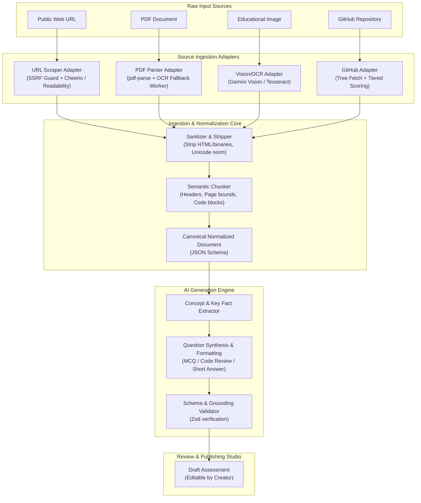
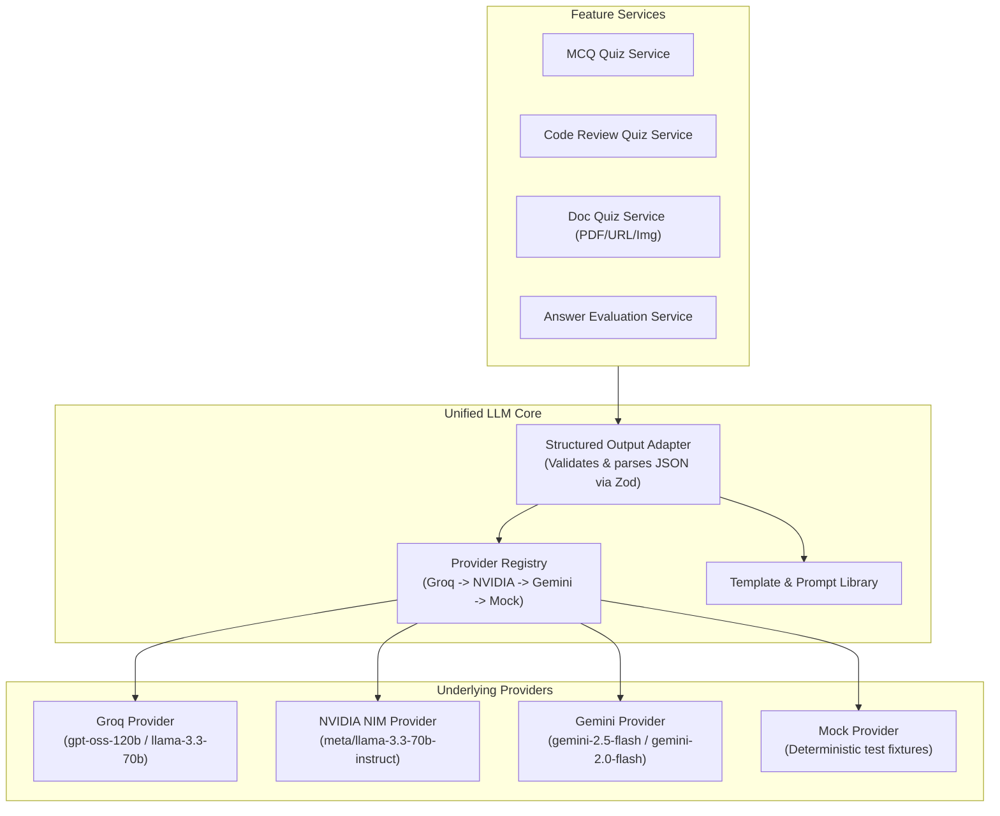
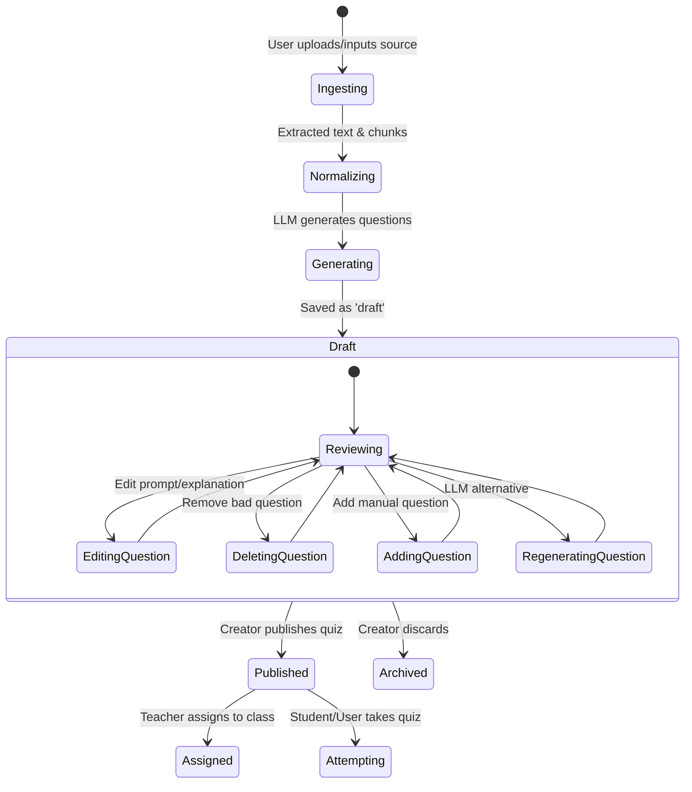
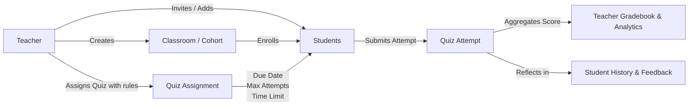
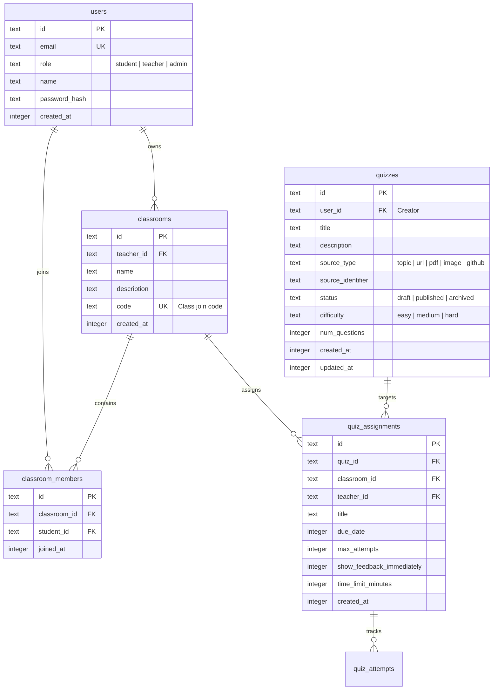
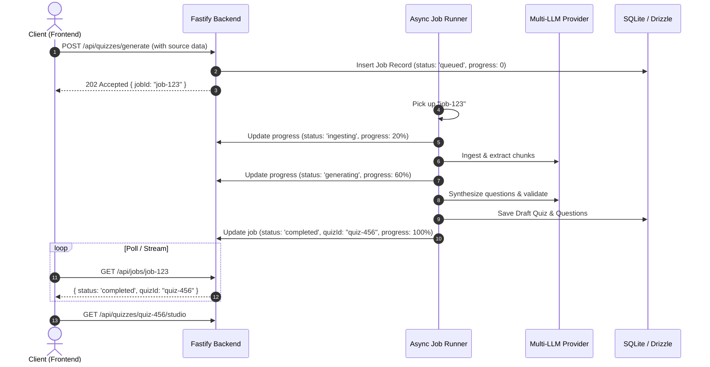
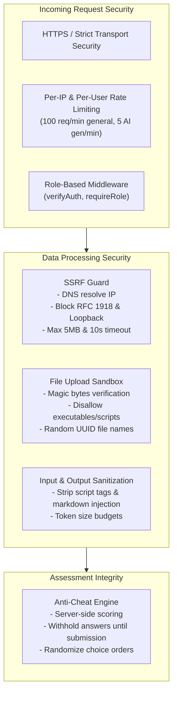
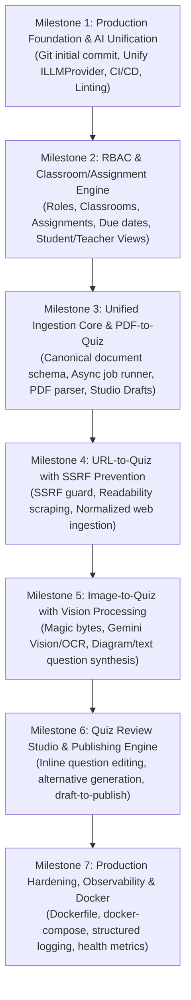

# QuizForge — Phase 1: Product & Architecture Blueprint & Implementation Roadmap

> **Document Status:** Complete Architecture Specification & Roadmap  
> **Author:** Antigravity (Principal Software Architect & Senior Full-Stack Engineer)  
> **Target:** QuizForge v2.0 Production-Grade Platform  
> **Prerequisites:** Phase 0 Audit Approved (73/73 Tests Passing, Builds Verified, Zero Regressions)

---

## 1. Executive Summary & Product Vision

QuizForge is evolving from a single-user quiz generator into a **production-grade, multi-source knowledge assessment platform**. It enables educators, students, and engineers to transform raw knowledge sources—web pages, PDF documents, instructional images, and source code repositories—into structured, pedagogical assessments with automated intelligent evaluation, role-based distribution, and performance tracking.

### Core Value Pillars
1. **Source Authenticity & Traceability:** Every question generated maps directly to verifiable source text, code snippet, section, or page. No hallucinated facts or generic filler.
2. **Pedagogical Control (Human-in-the-Loop):** Instructors and creators inspect, edit, prune, and calibrate questions before publishing or assigning.
3. **Multi-Source Ingestion Pipeline:** A single unified ingestion abstraction processes heterogeneous sources (Web URL, PDF, Image, GitHub) into normalized canonical documents.
4. **Universal AI Provider Layer:** Groq, NVIDIA NIM, Google Gemini, and mock fallbacks are interchangeable across both structured question generation and qualitative answer evaluation.
5. **Classroom & Assignment Ecosystem:** Teachers organize classes, assign quizzes with due dates and attempt limits, and track student mastery; students access authorized assessments and review historical growth.
6. **Production Reliability & Security:** Strict SSRF guards on web scraping, magic-byte file validation, sandboxed background processing, and predictable rate limiting.

---

## 2. Non-Negotiable Architectural Principles

- **Zero Regression Policy:** All 73 existing backend tests (auth, MCQ engine, GitHub code review, security, anti-cheat) must remain green across every phase.
- **Preserve What Works:** The existing SQLite + Drizzle ORM + Fastify v5 + React 19 stack is sound and fast. We extend and modularize without ground-up rewrites.
- **Separation of Concerns:** Ingestion, document normalization, question generation, quiz authoring, and assessment execution are decoupled services.
- **Fail-Safe AI Degradation:** If Groq hits a TPM rate limit or NVIDIA experiences downtime, the system automatically degrades to Gemini or queued retry, surfacing meaningful telemetry rather than crashing.

---

## 3. Unified Content Ingestion & Normalization Architecture

Rather than building 4 independent, siloed ingestion pipelines, QuizForge employs a **Canonical Ingestion Pipeline**:



### 3.1 The Canonical Document Schema (`NormalizedDocument`)

All ingestion adapters produce a standardized data structure defined in `@quiz-forge/shared`:

```typescript
export interface DocumentChunk {
  id: string;
  orderIndex: number;
  sectionTitle?: string;
  pageNumber?: number;
  filePath?: string;       // For code repositories
  content: string;         // Plain text or code snippet
  tokenEstimate: number;
}

export interface NormalizedDocument {
  sourceType: 'url' | 'pdf' | 'image' | 'github';
  sourceIdentifier: string; // URL, filename, or repo name
  title: string;
  metadata: {
    mimeType?: string;
    fileSizeBytes?: number;
    extractedAt: number;
    pageCount?: number;
    checksumSha256: string;
  };
  chunks: DocumentChunk[];
  totalTokenEstimate: number;
}
```

### 3.2 Ingestion Adapter Specifications

#### A. URL-to-Quiz Ingestion
- **Protocol:** HTTP/HTTPS only.
- **SSRF Defense:** 
  1. DNS pre-lookup: Resolve hostname to IP before fetching.
  2. IP blacklist verification: Reject loopback (`127.0.0.0/8`), private subnets (`10.0.0.0/8`, `172.16.0.0/12`, `192.168.0.0/16`), link-local (`169.254.0.0/16`), IPv6 loopback (`::1`), and cloud metadata IP (`169.254.169.254`).
  3. Strict timeout (10 seconds) and maximum response size (5 MB).
- **Text Extraction:** Uses Mozilla Readability heuristics + Cheerio to isolate article content, discarding navigation headers, footers, advertisements, and script tags.

#### B. PDF-to-Quiz Ingestion
- **Validation:** Enforces maximum file size (15 MB), MIME type check (`application/pdf`), and magic bytes validation (`%PDF-`).
- **Text Extraction:** Uses `pdf-parse` (or native stream parser) extracting page-by-page text with headers.
- **Scanned PDF / OCR Handling:** When extracted character density is below threshold (< 50 printable characters per page), routes page to the OCR vision service with explicit user feedback indicating OCR processing.

#### C. Image-to-Quiz Ingestion
- **Validation:** Supported formats: PNG, JPEG, WebP. Max 8 MB. Magic byte verification (`89 50 4E 47`, `FF D8 FF`, `52 49 46 46`).
- **Processing:** Multimodal vision API (Gemini 2.5/Flash or NVIDIA Vision NIM) with an extraction-only prompt that transcribes text, mathematical equations, diagrams, and labels verbatim.
- **Attribution:** Maintains coordinate/label context so generated questions reference specific visual elements (e.g., "In the architecture diagram shown in Figure 1...").

#### D. GitHub-to-Quiz Ingestion (Preserved & Enhanced)
- Retains existing tiered priority scoring (10: config, 8: entry points, 7: domain/services, 5: routes, 3-4: utils/types).
- Respects token budgets (15 KB content cap) and comments-as-intent analysis.
- Generates adversarial review questions challenging architectural understanding.

---

## 4. Universal AI / LLM Provider Architecture

### 4.1 Consolidating the Dual AI Layers

Currently, QuizForge has two disparate layers:
- `services/ai/` — `IAIQuestionGenerator` (MCQ only, hardcoded to Gemini or Mock)
- `services/llm/` — `ILLMProvider` (Multi-provider Groq / NVIDIA / Gemini / Mock)

**Unification Plan:**
We deprecate the separate `IAIQuestionGenerator` and route **all** AI generation through a unified `LLMService` backed by `ILLMProvider`:



### 4.2 Structured Output Resilience Engine
Different providers handle JSON structuring differently:
- **Gemini:** Native `responseSchema` enforcing exact JSON schema.
- **Groq:** OpenAI-compatible `response_format: { type: "json_object" }`.
- **NVIDIA NIM:** OpenAI-compatible JSON mode with system prompt reinforcement.

The `StructuredOutputAdapter` standardizes this:
1. Translates the target Zod schema into JSON Schema.
2. Formats provider-specific instructions and parameters.
3. Automatically fixes trailing commas or Markdown backticks in raw string output before Zod parsing.
4. Executes a single auto-retry with diagnostic feedback if schema validation fails.

---

## 5. Review & Publishing Studio Workflow

In production, generating a quiz should not immediately lock it into stone. Users must have the option to review, modify, and curate questions.



### Studio Capabilities:
- **Preview:** See each question, choices, correct indicator, and pedagogical explanation.
- **Inline Editing:** Edit question prompt, answer choices, or explanation.
- **Item Removal:** Remove flawed or redundant questions; reorder questions.
- **Alternative Regeneration:** Ask LLM: "Generate 1 replacement question focusing on Section 3".
- **Source Context Display:** View the original chunk or code snippet that inspired the question alongside it.

---

## 6. Classroom, Assignment & Role-Based Access Control (RBAC)

To support the directive where **"teacher can assign tasks to students or students can see their previous score and attempt their authorized quizzes or test"**, we establish a clean role model:

### 6.1 User Roles
- `student`: Can view assigned quizzes, attempt authorized quizzes, retake allowed quizzes, view personal attempt history and performance analytics.
- `teacher`: Inherits student permissions + create classrooms, invite students, author/generate quizzes, assign quizzes with parameters, review class aggregated performance and individual submissions.
- `admin`: System-wide observability, user management, global quiz management.

### 6.2 Classroom & Assignment Data Flow



### 6.3 Assignment Configuration Rules
- `dueDate`: Optional timestamp after which submissions are marked late or locked.
- `maxAttempts`: 1 (strict exam), 2-5 (learning mode), or unlimited (practice).
- `showFeedbackImmediately`: Boolean; whether correct answers and AI feedback are visible immediately upon completion or withheld until the due date passes.
- `shuffleQuestions`: Per-student question ordering to reduce answer sharing.

---

## 7. Data Model & Database Evolution Plan

### 7.1 SQLite vs PostgreSQL Evaluation

| Dimension | Current (SQLite + WAL) | Future Target (PostgreSQL) | Strategic Decision |
|---|---|---|---|
| **Current Performance** | In-memory / fast file, ~1ms queries, WAL mode enabled | Network latency (~5-15ms), robust connection pooling | **Retain SQLite for Phase 1-6**, design Drizzle schemas to be 100% portable to Postgres. |
| **Concurrency** | Single-writer, multiple-readers (fine for hundreds of concurrent users with WAL) | High concurrent write throughput (thousands of students submitting simultaneously) | Migrate to PostgreSQL if/when horizontal scaling across multiple container replicas is needed. |
| **Migrations** | Drizzle migrations fully operational | Same Drizzle migration toolchain | Zero lock-in: Drizzle abstracts SQL dialects. |
| **Storage Complexity**| Zero configuration, portable single file | Requires Docker / RDS / Supabase instance | SQLite keeps local dev friction zero while maintaining test performance. |

### 7.2 Database Schema Additions (Drizzle ORM)



*Note: Existing `quizzes`, `questions`, `choices`, `quiz_attempts`, `attempt_answers`, `code_quizzes`, `code_questions`, `code_attempts`, and `code_answers` are preserved completely with non-destructive foreign key references.*

---

## 8. Asynchronous Processing & Background Jobs

AI generation (especially PDF OCR or web scraping + multi-file question synthesis) can take 15–45 seconds. Synchronous HTTP request handlers risk browser timeouts and poor UX.

### Architecture:


- **Implementation:** Fast, self-contained background queue (`p-queue` + SQLite state tracking) requiring no external Redis service.
- **Resilience:** Automatic timeout handling (maximum 60s per job) and descriptive error capture.

---

## 9. Security Threat Model & Hardening



### Security Guard Details:
1. **SSRF Guard Service (`ssrf-guard.ts`):** 
   - Uses `node:dns/promises` to verify IPv4 and IPv6 target addresses before executing any fetch.
   - Forbids `localhost`, `127.0.0.1`, `::1`, `10.0.0.0/8`, `172.16.0.0/12`, `192.168.0.0/16`, `169.254.169.254`.
2. **File Upload Security (`file-upload.service.ts`):**
   - Fastify `@fastify/multipart` with 15MB file cap.
   - Inspects file headers (magic bytes) to guarantee legitimate PDF/PNG/JPEG formats rather than trusting user-supplied MIME extensions.
   - Writes to a strictly isolated temporary directory with immediate cleanup post-ingestion.
3. **Environment Hardening (`env.ts`):**
   - In `NODE_ENV === 'production'`, `JWT_SECRET` must be at least 32 characters with zero default fallback.

---

## 10. Frontend Architecture & Design System

The frontend will evolve from individual decoupled player pages into a cohesive **Educational Assessment Workspace**:

### Navigation Structure
- **Global Header:** Active Role Switcher / Indicator (Teacher / Student view), Notification / Assignment alerts, User Profile menu.
- **Student View:**
  - `My Assignments`: Pending tasks with due date indicators, progress, and attempt counts.
  - `Practice Quizzes`: Generate on-demand (URL, PDF, Image, Topic, GitHub).
  - `Score & History`: Unified view of past attempts, score trends, and review breakdowns.
- **Teacher View:**
  - `Classrooms`: Manage classes, student rosters, join codes.
  - `Quiz Studio`: Multi-source generation modal, draft editor, question customizer.
  - `Assignment Manager`: Create assignments, set deadlines, track completion rates.
  - `Analytics & Gradebook`: Aggregate question difficulty statistics, student scores.

### New & Enhanced UI Pages:
1. `ClassroomListPage.tsx` & `ClassroomDetailPage.tsx`
2. `QuizStudioPage.tsx` (Draft editor with drag-and-drop ordering, inline editing, alternative generator)
3. `AssignmentPlayerPage.tsx` (Standardized player for assigned quizzes respecting time limits and attempt rules)
4. `TeacherAnalyticsPage.tsx` (Student performance matrix, item analysis)

---

## 11. Testing & Quality Assurance Architecture

### Verification Strategy
1. **Preserve Current Suite:** 73/73 tests continue to pass in every git commit and CI run.
2. **Frontend Testing Suite:**
   - Configure **Vitest + React Testing Library** in `apps/frontend`.
   - Unit tests for all pure components (`ScoreCard`, `QuestionPalette`, `ProgressBar`, `OptionCard`).
   - Integration tests for `useQuizAttempt` and `QuizStudio` workflows.
3. **Ingestion & Security Test Suite:**
   - SSRF Guard tests (loopback rejection, link-local rejection, valid external URLs).
   - Magic byte validation tests (rejecting executable with `.pdf` extension).
   - Job queue lifecycle tests (queued -> processing -> completed / failed).
4. **CI/CD Automation:**
   - GitHub Actions workflow testing `pnpm typecheck`, `pnpm test`, and `pnpm build` on every push and pull request.

---

## 12. Phase 2: Prioritized Implementation Roadmap

To maintain engineering discipline and guarantee product stability, the implementation is broken into **7 discrete, sequential Milestones**. Each milestone has clear deliverables, automated test gates, and requires approval before moving to the next.



### Milestone Breakdown

#### Milestone 1: Production Foundation & AI Unification
- **Objectives:**
  - Create initial clean Git commit on repository.
  - Setup ESLint, Prettier, and GitHub Actions CI workflow.
  - Consolidate `services/ai` and `services/llm` into a single unified `LLMService` supporting Groq, NVIDIA, Gemini, and Mock across all quiz formats.
  - Fix abort controller signal bug in `gemini-chat.provider.ts`.
  - Fix duplicate restart route in `code-quiz.routes.ts`.
- **Verification Gate:** All 73 tests passing + new LLM adapter unit tests.

#### Milestone 2: RBAC & Classroom Assignment Engine
- **Objectives:**
  - Add `role` (`student`, `teacher`, `admin`) to `users` schema.
  - Add `classrooms`, `classroom_members`, and `quiz_assignments` tables with Drizzle migrations.
  - Implement Teacher Assignment APIs (`POST /api/classrooms`, `POST /api/assignments`, `GET /api/assignments/student`).
  - Frontend: Teacher Dashboard & Student Assigned Tasks view.
- **Verification Gate:** Full RBAC permission test suite + assignment attempt lifecycle tests.

#### Milestone 3: Unified Ingestion Core & PDF-to-Quiz
- **Objectives:**
  - Implement Canonical Ingestion Pipeline & `NormalizedDocument` schema in `@quiz-forge/shared`.
  - Implement in-process asynchronous job queue (`p-queue` + job status polling endpoints).
  - Add `@fastify/multipart` with secure file validation (magic bytes, size caps).
  - Build `PDFIngestionAdapter` with section chunking.
  - Frontend: PDF Upload modal with real-time job progress bar.
- **Verification Gate:** PDF ingestion test suite with valid/corrupt/oversized PDF fixtures.

#### Milestone 4: URL-to-Quiz with SSRF Defense
- **Objectives:**
  - Implement `SSRFGuardService` with DNS resolution and private network blocking.
  - Build `URLIngestionAdapter` using Cheerio and content extraction heuristics.
  - Connect URL ingestion to the canonical pipeline and background job queue.
  - Frontend: URL input tab in Quiz Generator with live preview.
- **Verification Gate:** SSRF security test suite asserting rejection of localhost, 127.0.0.1, 169.254.169.254, and private ranges.

#### Milestone 5: Image-to-Quiz with Vision Processing
- **Objectives:**
  - Implement `ImageIngestionAdapter` with multimodal vision processing (Gemini Vision / NVIDIA Vision NIM).
  - Traceability mapping: connect generated questions to visual diagram components.
  - Magic bytes verification for PNG, JPEG, WebP.
  - Frontend: Image upload tab with visual preview.
- **Verification Gate:** Image processing test suite with sample diagrams and notes.

#### Milestone 6: Quiz Review Studio & Publishing Engine
- **Objectives:**
  - Support `draft` vs `published` lifecycle in database.
  - Implement Studio APIs (`PUT /api/quizzes/:id/questions`, `DELETE /api/quizzes/:id/questions/:qId`, `POST /api/quizzes/:id/publish`).
  - Frontend `QuizStudioPage.tsx`: inline question editing, reordering, deleting, and single-item AI regeneration.
- **Verification Gate:** Full quiz curation e2e test (Generate draft -> Edit question -> Publish -> Take quiz).

#### Milestone 7: Production Hardening, Observability & Docker
- **Objectives:**
  - Multi-stage `Dockerfile` and `docker-compose.yml` for production builds.
  - Production static file serving configuration.
  - Structured request logging with trace IDs and health metrics (`/api/health` with DB latency and memory stats).
  - Setup Vitest in `apps/frontend` with component test coverage.
- **Verification Gate:** `docker compose up --build` boots clean and passes full e2e test suite against container.

---

## 13. Next Steps & Approval Request

This document establishes the architectural blueprint and execution roadmap for transforming QuizForge into a complete, production-grade platform. 

Upon user approval of this blueprint:
1. We will make an **initial Git commit** to baseline the clean, tested repository.
2. We will immediately commence **Milestone 1: Production Foundation & AI Unification**.
