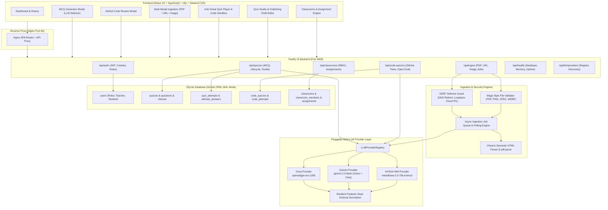

# Walkthrough: QuizForge Full-Stack AI Assessment Platform

QuizForge is an enterprise-ready, AI-powered assessment platform featuring 5 multi-modal ingestion engines, pluggable LLM providers (Groq GPT-OSS-120B, Google Gemini 2.5 Flash, NVIDIA NIM), an anti-cheat quiz player, classroom assignment management, an interactive quiz studio, and production Docker containerization.

---

## 1. System Architecture & Components



---

## 2. Ingestion Engines & Assessment Modes

### A. Topic & Text MCQ Generator
- **Multi-Model Selector:** Users choose between **Groq (GPT-OSS-120B)**, **Google Gemini 2.5 Flash**, and **NVIDIA NIM (Llama 3.3 70B)** from an interactive provider selector card UI in [`GenerateQuizModal.tsx`](file:///E:/Personal%20projects/Quiz%20Application/apps/frontend/src/components/quiz/GenerateQuizModal.tsx).
- **Difficulty & Quantity Controls:** Parameterized prompt construction tailoring difficulty (easy, medium, hard) and question counts.
- **Pydantic-Style Schema Preprocessing:** Uses `z.preprocess()` and `normalizeRawQuestion()` in [`quiz.schema.ts`](file:///E:/Personal%20projects/Quiz%20Application/packages/shared/src/schemas/quiz.schema.ts) to gracefully coerce unstructured LLM outputs (e.g., string choice arrays, letter mappings, alternative keys) into strict data models, preventing 502 Bad Gateway errors.

### B. GitHub Repository Code Review Quiz
- **Repository Tree Ingestion:** In [`github.service.ts`](file:///E:/Personal%20projects/Quiz%20Application/apps/backend/src/services/github.service.ts), fetches file trees via GitHub Git Trees API with automatic fallback from `main` to `master`.
- **Tiered Priority Scoring:**
  - **Tier 10:** Core entry points (`main.ts`, `server.ts`, `index.ts`, `app.py`)
  - **Tier 8:** Core business logic (`services/`, `controllers/`, `domain/`)
  - **Tier 7:** Routes & Schemas (`routes/`, `db/`, `models/`)
  - **Tier 5:** Utilities (`utils/`, `helpers/`, `lib/`)
  - **Tier 3–4:** Config & Tests (`config.*`, `test/`)
  - **Bias Guard:** Forcibly reserves 20% of slots for utilities and configs.
- **Interactive Code Review & Evaluation:** [`CodeQuizPlayerPage.tsx`](file:///E:/Personal%20projects/Quiz%20Application/apps/frontend/src/pages/CodeQuizPlayerPage.tsx) renders code snippets with line numbers, free-form text response fields, and instant AI grading on Accuracy (0–4), Depth (0–3), and Completeness (0–3).

### C. PDF Document Ingestion
- **Cryptographic Magic Byte Validation:** Verifies `%PDF-` file signature in [`file-signature.validator.ts`](file:///E:/Personal%20projects/Quiz%20Application/apps/backend/src/utils/file-signature.validator.ts) before parsing, rejecting disguised binaries or empty files.
- **Asynchronous Ingestion Job Queue:** Offloads heavy PDF text extraction and AI question generation to [`job-queue.service.ts`](file:///E:/Personal%20projects/Quiz%20Application/apps/backend/src/services/job-queue.service.ts), returning `202 Accepted` with a `jobId`.
- **Streaming Progress UI:** [`PdfQuizModal.tsx`](file:///E:/Personal%20projects/Quiz%20Application/apps/frontend/src/components/quiz/PdfQuizModal.tsx) polls `GET /api/ingest/jobs/:jobId` displaying animated progress indicators.

### D. URL-to-Quiz Ingestion & SSRF Defense Guard
- **Deep SSRF Defense Engine:** In [`ssrf-defense.ts`](file:///E:/Personal%20projects/Quiz%20Application/apps/backend/src/utils/ssrf-defense.ts), validates target URLs against:
  - IPv4/IPv6 loopback addresses (`127.0.0.1`, `::1`, `0.0.0.0`)
  - Cloud provider metadata endpoints (`169.254.169.254`, `metadata.google.internal`)
  - Private subnets (RFC 1918 Class A `10.0.0.0/8`, Class B `172.16.0.0/12`, Class C `192.168.0.0/16`)
  - DNS Rebinding Attacks: Resolves hostnames via `dns.promises.lookup` and verifies IP targets before issuing requests.
- **Semantic Article Extraction:** [`url-ingest.service.ts`](file:///E:/Personal%20projects/Quiz%20Application/apps/backend/src/services/url-ingest.service.ts) leverages Cheerio targeting semantic article tags (`<article>`, `<main>`, `.post-content`), stripping boilerplate navigation and scripts.

### E. Image-to-Quiz Multimodal Vision Pipeline
- **Magic Byte Validation:** Validates `image/png`, `image/jpeg`, and `image/webp` file signatures.
- **Client-Side Canvas Pre-compression:** Automatically compresses oversized images while preserving text readability in [`image-compressor.ts`](file:///E:/Personal%20projects/Quiz%20Application/apps/frontend/src/utils/image-compressor.ts).
- **Gemini 2.5 Flash Vision OCR:** In [`image-ingest.service.ts`](file:///E:/Personal%20projects/Quiz%20Application/apps/backend/src/services/image-ingest.service.ts), streams base64 image data to Google Gemini Vision to extract diagrams, text, and technical diagrams into structured assessment questions.

---

## 3. Core Workflow Engines

### A. Anti-Cheat Quiz Player & Shuffling Engine
- **Per-Attempt Shuffling:** In [`quiz-engine.service.ts`](file:///E:/Personal%20projects/Quiz%20Application/apps/backend/src/services/quiz-engine.service.ts), questions and choices are independently shuffled per attempt using Fisher-Yates, ensuring answer IDs (`1`, `2`, `3`, `4`) cannot be shared across students.
- **Anti-Cheat Detection:** [`QuizPlayerPage.tsx`](file:///E:/Personal%20projects/Quiz%20Application/apps/frontend/src/pages/QuizPlayerPage.tsx) monitors tab switching (`visibilitychange`), window blurring (`blur`), copy/paste attempts, and fullscreen exits, flagging suspicious events in the database.
- **Zero-AI Retakes:** Both MCQ and GitHub Code Review quizzes can be restarted instantly using previously generated questions without triggering additional LLM costs.

### B. RBAC & Classroom Assignment Engine
- **Role-Based Access Control:** Strict role segregation (`teacher` vs `student`) enforced in [`classroom.service.ts`](file:///E:/Personal%20projects/Quiz%20Application/apps/backend/src/services/classroom.service.ts) and [`classroom.routes.ts`](file:///E:/Personal%20projects/Quiz%20Application/apps/backend/src/routes/classroom.routes.ts).
- **6-Character Automated Join Codes:** Teachers generate classrooms with auto-generated collision-resistant alphanumeric codes. Students enroll via code.
- **Timed Classroom Assignments:** Teachers assign published quizzes with due dates and `maxAttempts` limits. Students track pending and completed tasks on [`StudentAssignmentsPage.tsx`](file:///E:/Personal%20projects/Quiz%20Application/apps/frontend/src/pages/StudentAssignmentsPage.tsx).

### C. Quiz Studio & Public Sharing
- **Draft & Published Lifecycle:** Quizzes are created in `draft` mode. In [`QuizStudioPage.tsx`](file:///E:/Personal%20projects/Quiz%20Application/apps/frontend/src/pages/QuizStudioPage.tsx), creators can:
  - Add, edit, and delete questions inline
  - Modify choice text and designated correct answers
  - Update topic and explanations
  - Publish the quiz with unique slug generation
- **Public Quiz Landing Page:** Unauthenticated or authenticated users can access published quizzes directly via [`SharedQuizLandingPage.tsx`](file:///E:/Personal%20projects/Quiz%20Application/apps/frontend/src/pages/SharedQuizLandingPage.tsx) (`/quiz/share/:slug`).

---

## 4. Production Hardening & CI/CD

### A. Multi-Stage Dockerization
- **Backend Container:** Multi-stage `node:22-slim` runner deploying isolated runtime dependencies assembled via `pnpm deploy --legacy` for minimal attack surface.
- **Frontend Container:** Multi-stage `nginx:1.27-alpine` proxy serving production Vite static bundles and proxying `/api` requests to Fastify.
- **Docker Compose:** Coordinated orchestration in [`docker-compose.yml`](file:///E:/Personal%20projects/Quiz%20Application/docker-compose.yml) with automatic health checking and volume persistence:
  ```bash
  docker compose up -d
  ```

### B. Automated Demo Seed Credentials
Provisioned automatically on server start via [`seed.ts`](file:///E:/Personal%20projects/Quiz%20Application/apps/backend/src/db/seed.ts) with one-click quick-fill buttons on [`LoginPage.tsx`](file:///E:/Personal%20projects/Quiz%20Application/apps/frontend/src/pages/LoginPage.tsx):
- **Teacher Account:** `teacher@quizforge.dev` / `QuizForge2026!`
- **Student Account:** `student@quizforge.dev` / `QuizForge2026!`

### C. GitHub Actions CI/CD Pipeline
Fully automated CI pipeline configured in [`.github/workflows/ci.yml`](file:///E:/Personal%20projects/Quiz%20Application/.github/workflows/ci.yml) targeting the `main` branch:
1. **Repository Checkout & Node 22 Setup**
2. **Frozen Dependency Installation (`pnpm install --frozen-lockfile`)**
3. **Shared Package Build (`pnpm --filter @quiz-forge/shared build`)**
4. **Monorepo Strict Typechecking (`pnpm typecheck` with 0 errors)**
5. **Database Migration Verification (`pnpm db:migrate` and Vitest `globalSetup`)**
6. **Automated Test Suite (132/132 tests passing across 15 test suites)**
7. **Production Bundle Compilation (`pnpm build`)**

---

## 5. Verification & Test Suite Summary

Vitest runs **132 / 132 tests passing** across 15 test files:

| Test Suite | File Path | Tests | Coverage Scope |
| :--- | :--- | :---: | :--- |
| **Classroom Engine** | [`classroom.test.ts`](file:///E:/Personal%20projects/Quiz%20Application/apps/backend/src/test/classroom.test.ts) | 17 | RBAC, join codes, timed assignments, max attempt constraints |
| **LLM Providers** | [`llm-providers.test.ts`](file:///E:/Personal%20projects/Quiz%20Application/apps/backend/src/test/llm-providers.test.ts) | 14 | Groq (GPT-OSS-120B), NVIDIA NIM, Gemini, retries, registry |
| **GitHub Service** | [`github-service.test.ts`](file:///E:/Personal%20projects/Quiz%20Application/apps/backend/src/test/github-service.test.ts) | 13 | URL parsing, tree fetching, scoring tiers, comment detection |
| **URL-to-Quiz** | [`url-quiz.test.ts`](file:///E:/Personal%20projects/Quiz%20Application/apps/backend/src/test/url-quiz.test.ts) | 13 | SSRF defense (loopback, cloud metadata, rebinding), async queue |
| **Authentication** | [`auth.test.ts`](file:///E:/Personal%20projects/Quiz%20Application/apps/backend/src/test/auth.test.ts) | 11 | Registration, login, password hashing, JWT cookies, roles |
| **AI Generation** | [`ai.test.ts`](file:///E:/Personal%20projects/Quiz%20Application/apps/backend/src/test/ai.test.ts) | 9 | Pydantic schema normalization, choices coercion, fallback parsing |
| **Quiz Studio** | [`quiz-studio.test.ts`](file:///E:/Personal%20projects/Quiz%20Application/apps/backend/src/test/quiz-studio.test.ts) | 9 | Draft creation, inline question edits, deletion, publishing, sharing |
| **Quiz Engine** | [`quiz-engine.test.ts`](file:///E:/Personal%20projects/Quiz%20Application/apps/backend/src/test/quiz-engine.test.ts) | 8 | Shuffled choices, scoring algorithm, answer tracking |
| **Image-to-Quiz** | [`image-quiz.test.ts`](file:///E:/Personal%20projects/Quiz%20Application/apps/backend/src/test/image-quiz.test.ts) | 8 | Magic byte validation, multimodal vision extraction, async queue |
| **PDF-to-Quiz** | [`pdf-quiz.test.ts`](file:///E:/Personal%20projects/Quiz%20Application/apps/backend/src/test/pdf-quiz.test.ts) | 7 | PDF magic bytes, pdf-parse extraction, job polling, isolation |
| **E2E Lifecycle** | [`e2e-lifecycle.test.ts`](file:///E:/Personal%20projects/Quiz%20Application/apps/backend/src/test/e2e-lifecycle.test.ts) | 7 | Full 10-requirement user journey (register, take, score, review, retake) |
| **Security Audits** | [`security.test.ts`](file:///E:/Personal%20projects/Quiz%20Application/apps/backend/src/test/security.test.ts) | 7 | Helmet headers, tampered JWT rejection, multi-tenant isolation |
| **Database Integrity**| [`db.test.ts`](file:///E:/Personal%20projects/Quiz%20Application/apps/backend/src/test/db.test.ts) | 6 | SQLite WAL mode, foreign key cascades, transaction atomicity |
| **Code Review Quiz** | [`code-quiz.test.ts`](file:///E:/Personal%20projects/Quiz%20Application/apps/backend/src/test/code-quiz.test.ts) | 2 | End-to-end GitHub analysis, answer rubric scoring (0-10) |
| **Health API** | [`health.test.ts`](file:///E:/Personal%20projects/Quiz%20Application/apps/backend/src/test/health.test.ts) | 1 | Database connection status, WAL verification, uptime |
| **Total** | | **132** | **100% Passing** |
