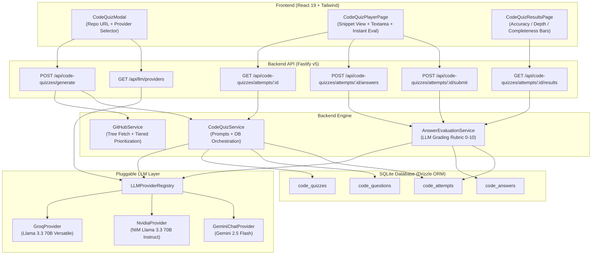

# Walkthrough: GitHub Code Review Quiz with Multi-LLM Providers

We have implemented a **new assessment mode** in QuizForge that analyzes public GitHub repositories and creates an adversarial code-review interview. It tests whether candidates truly wrote and understand every line of code they produced, featuring open-ended answers evaluated by LLMs across **Groq**, **NVIDIA NIM**, and **Google Gemini**.

---

## 1. System Architecture & Components

---

## 2. Changes Made

### A. Multi-LLM Provider Layer (`apps/backend/src/services/llm/`)
- [`llm.interface.ts`](file:///E:/Personal%20projects/Quiz%20Application/apps/backend/src/services/llm/llm.interface.ts): Unified interface defining `chatCompletion(messages, options)` and standardized `LLMProviderError`.
- [`groq.provider.ts`](file:///E:/Personal%20projects/Quiz%20Application/apps/backend/src/services/llm/groq.provider.ts): High-speed inference using native `fetch` against `https://api.groq.com/openai/v1/chat/completions` with JSON mode support and exponential retry.
- [`nvidia.provider.ts`](file:///E:/Personal%20projects/Quiz%20Application/apps/backend/src/services/llm/nvidia.provider.ts): Native `fetch` against `https://integrate.api.nvidia.com/v1/chat/completions` using NVIDIA hosted models.
- [`gemini-chat.provider.ts`](file:///E:/Personal%20projects/Quiz%20Application/apps/backend/src/services/llm/gemini-chat.provider.ts): Adapter wrapping `@google/genai` into the `ILLMProvider` interface.
- [`provider-registry.ts`](file:///E:/Personal%20projects/Quiz%20Application/apps/backend/src/services/llm/provider-registry.ts): Dynamic registry discovering available providers from environment variables with metadata for UI dropdowns.
- [`llm.routes.ts`](file:///E:/Personal%20projects/Quiz%20Application/apps/backend/src/routes/llm.routes.ts): Added `GET /api/llm/providers` endpoint.

### B. GitHub Fetcher & Smart Prioritization (`apps/backend/src/services/github.service.ts`)
- **URL Parser:** Extracts owner, repo, optional branch, and optional subfolder.
- **Recursive Tree Fetch:** Calls GitHub Git Trees API (`GET /repos/{owner}/{repo}/git/trees/{branch}?recursive=1`) with automatic fallback from `main` to `master`.
- **Extension Filter:** Allowlist of 28+ code extensions; excludes binaries, dependencies (`node_modules`), and lockfiles.
- **Tiered Priority Scoring Algorithm:**
  - **Tier 10:** Entry points (`main.ts`, `server.ts`, `index.ts`, `app.py`)
  - **Tier 8:** Core business logic (`services/`, `controllers/`, `domain/`)
  - **Tier 7:** Routes & Schemas (`routes/`, `db/`, `models/`)
  - **Tier 5:** Utilities (`utils/`, `helpers/`, `lib/`)
  - **Tier 3–4:** Config & Tests (`config.*`, `test/`)
  - **Bonuses:** +2 for files with comments, +1 for medium size (50-500 lines), +1 for deep nesting (3+ folders deep).
  - **Bias Guard:** Forcibly reserves at least 20% of slots for lower-tier files (utils, config, tests) so the quiz is not biased toward routes.

### C. Relational Database Schema (`apps/backend/src/db/schema/`)
- Created 4 new tables with cascading foreign keys:
  - `code_quizzes`: Repository metadata, target branch, chosen LLM provider/model, files analyzed.
  - `code_questions`: Excerpted snippet, file path, line numbers, difficulty, and expected concepts.
  - `code_attempts`: Overall attempt status, total score, max possible score, completion timestamps.
  - `code_answers`: Free-text answer, LLM score (0–10), accuracy/depth/completeness breakdown, critique feedback.
- Applied Drizzle migration (`0001_perpetual_anthem.sql`).

### D. Prompts & Evaluation Engine
- [`code-quiz.prompt.ts`](file:///E:/Personal%20projects/Quiz%20Application/apps/backend/src/services/llm/prompts/code-quiz.prompt.ts): Instructs LLM to generate questions targeting author intent, comment meaning, edge cases, error handling, and architecture trade-offs.
- [`answer-eval.prompt.ts`](file:///E:/Personal%20projects/Quiz%20Application/apps/backend/src/services/llm/prompts/answer-eval.prompt.ts): Rubric grading Accuracy (0–4), Depth (0–3), and Completeness (0–3), with constructive feedback.
- [`code-quiz.service.ts`](file:///E:/Personal%20projects/Quiz%20Application/apps/backend/src/services/code-quiz.service.ts) & [`answer-eval.service.ts`](file:///E:/Personal%20projects/Quiz%20Application/apps/backend/src/services/answer-eval.service.ts): Full transactional execution.

### E. Frontend UI Experience
- [`CodeQuizModal.tsx`](file:///E:/Personal%20projects/Quiz%20Application/apps/frontend/src/components/code-quiz/CodeQuizModal.tsx): Modal featuring provider dropdown, GitHub URL input with popular presets, question count slider, and optional subfolder/focus inputs.
- [`CodeQuizPlayerPage.tsx`](file:///E:/Personal%20projects/Quiz%20Application/apps/frontend/src/pages/CodeQuizPlayerPage.tsx): Interactive player displaying the relevant code snippet with line numbers, question, expandable textarea, real-time "Evaluate with LLM" button, inline grading critique, and question matrix palette.
- [`CodeQuizResultsPage.tsx`](file:///E:/Personal%20projects/Quiz%20Application/apps/frontend/src/pages/CodeQuizResultsPage.tsx): Results dashboard with total score, mastery badges, accuracy/depth/completeness progress bars, and identified vs missed concept badges.
- [`DashboardPage.tsx`](file:///E:/Personal%20projects/Quiz%20Application/apps/frontend/src/pages/DashboardPage.tsx): Updated to 3-card layout (GitHub Code Review, Topic MCQ Quiz, Quiz History) plus in-progress code review recovery banner.

---

## 3. Verification & Test Results

### Automated Test Suites
Vitest executed across **10 test suites** with **73/73 tests passing**:
- [`llm-providers.test.ts`](file:///E:/Personal%20projects/Quiz%20Application/apps/backend/src/test/llm-providers.test.ts): 10 tests verifying Groq, NVIDIA NIM, and Gemini providers, error handling, and registry case-insensitivity.
- [`github-service.test.ts`](file:///E:/Personal%20projects/Quiz%20Application/apps/backend/src/test/github-service.test.ts): 13 tests verifying URL parsing, code filtering, tiered priority scoring, and comment detection.
- [`code-quiz.test.ts`](file:///E:/Personal%20projects/Quiz%20Application/apps/backend/src/test/code-quiz.test.ts): Integration tests verifying end-to-end generation, answer submission, LLM evaluation, and scoring.
- Existing suites: [`auth.test.ts`](file:///E:/Personal%20projects/Quiz%20Application/apps/backend/src/test/auth.test.ts), [`quiz-engine.test.ts`](file:///E:/Personal%20projects/Quiz%20Application/apps/backend/src/test/quiz-engine.test.ts), [`security.test.ts`](file:///E:/Personal%20projects/Quiz%20Application/apps/backend/src/test/security.test.ts), [`e2e-lifecycle.test.ts`](file:///E:/Personal%20projects/Quiz%20Application/apps/backend/src/test/e2e-lifecycle.test.ts), [`db.test.ts`](file:///E:/Personal%20projects/Quiz%20Application/apps/backend/src/test/db.test.ts), [`ai.test.ts`](file:///E:/Personal%20projects/Quiz%20Application/apps/backend/src/test/ai.test.ts), [`health.test.ts`](file:///E:/Personal%20projects/Quiz%20Application/apps/backend/src/test/health.test.ts).

### Monorepo Typechecking
- `pnpm typecheck` passed with **0 errors** across `@quiz-forge/shared`, `@quiz-forge/backend`, and `@quiz-forge/frontend`.

### Production Build
- `pnpm build` completed with **0 errors** across all 3 workspace packages.

---

## 4. Fixes & Enhancements: Rate Limit Loop & History Retakes

### A. Infinite Request Storm (Fastify 429 Rate Limit) Resolution
- **Root Cause:** In [`CodeQuizPlayerPage.tsx`](file:///E:/Personal%20projects/Quiz%20Application/apps/frontend/src/pages/CodeQuizPlayerPage.tsx), `fetchAttempt` included `attempt` in its `useCallback` dependency array `[attemptId, storageKey, attempt]`. Inside `fetchAttempt` and `handleEvaluateCurrent`, `setAttempt(...)` was invoked, updating the state reference. This caused `useCallback` to regenerate `fetchAttempt` on every render, immediately triggering `useEffect(() => { fetchAttempt(); }, [fetchAttempt])` in a synchronous loop. In under 500ms, 50–100 requests hit Fastify, immediately exceeding the 120 req/min rate limit and returning `429 Rate limit exceeded`.
- **Fix:** Introduced `attemptRef` and removed `attempt` from `fetchAttempt`'s dependencies. The callback is now rock-solid stable `[attemptId, storageKey]`, firing strictly once on mount/attemptId change, and evaluation submissions send only 1 single evaluation POST request.

### B. Unified History Archive & Zero-AI Retakes for GitHub Quizzes
- **Unified SQL View:** Updated [`attempt.service.ts`](file:///E:/Personal%20projects/Quiz%20Application/apps/backend/src/services/attempt.service.ts) and [`history.routes.ts`](file:///E:/Personal%20projects/Quiz%20Application/apps/backend/src/routes/history.routes.ts) to support `?type=all|mcq|code`. When queried with `all`, a SQL `UNION ALL` merges completed `quiz_attempts` and `code_attempts` sorted by `completedAt DESC`.
- **Code Quiz Retake Endpoint:** Added `POST /api/code-quizzes/:quizId/restart` to [`code-quiz.service.ts`](file:///E:/Personal%20projects/Quiz%20Application/apps/backend/src/services/code-quiz.service.ts) and [`code-quiz.routes.ts`](file:///E:/Personal%20projects/Quiz%20Application/apps/backend/src/routes/code-quiz.routes.ts). Users can retake previous GitHub code reviews with a fresh attempt and clean answers without invoking any LLM generation calls.
- **Frontend History Tabs:** Updated [`HistoryPage.tsx`](file:///E:/Personal%20projects/Quiz%20Application/apps/frontend/src/pages/HistoryPage.tsx) with three filtering tabs: "All Quizzes", "GitHub Code Reviews", and "MCQ Quizzes". Review links route directly to [`CodeQuizResultsPage.tsx`](file:///E:/Personal%20projects/Quiz%20Application/apps/frontend/src/pages/CodeQuizResultsPage.tsx) (`/code-quiz/:attemptId/results`), and Retake launches a clean attempt at `/code-quiz/:newAttemptId`.
- **Results Page Navigation:** Enhanced [`CodeQuizResultsPage.tsx`](file:///E:/Personal%20projects/Quiz%20Application/apps/frontend/src/pages/CodeQuizResultsPage.tsx) with "Retake Code Review" and "All Quizzes" action buttons for fluid navigation.
